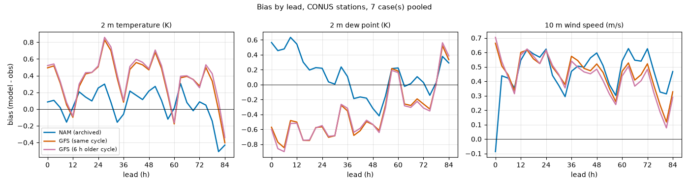
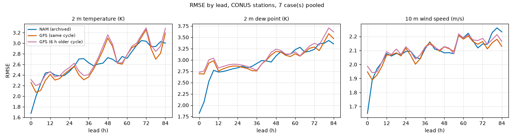
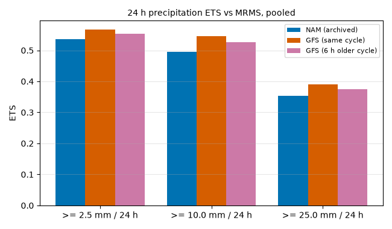
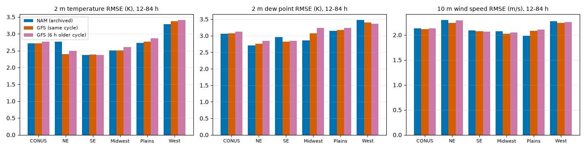
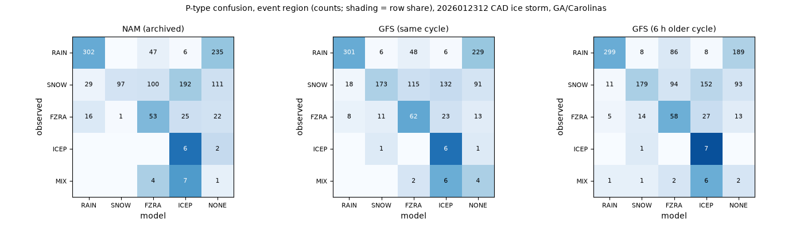
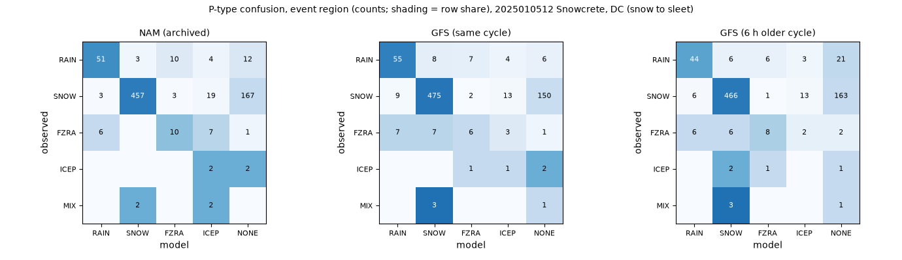
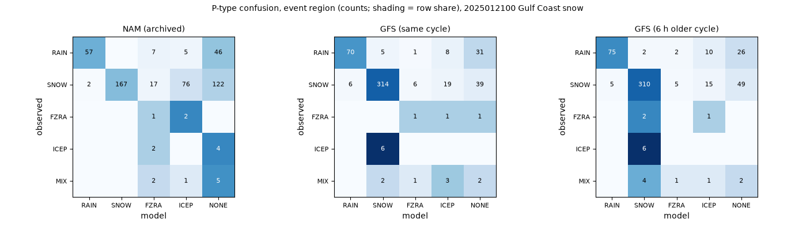

# Scorecard: NAM (archived), GFS (same cycle), GFS (6 h older cycle) against observations

## Reading (short, honest)

Seven cases, 12-84 h, all against observations: ASOS/AWOS stations (about 390,000 station-hours per variable), MRMS 24 h QPE
(Pass2, gauge-corrected) and SNOTEL. These are cases picked for weather, not a random sample, and the seven are not independent
samples of anything. No significance tests; differences of a few hundredths of a K or m/s are noise.

**Where the old NAM beat the GFS against observations**
- 2 m dew point: lower bias (+0.06 K against -0.34 K, the GFS is too dry everywhere) and a clearly better first day (3-24 h RMSE
  2.67 vs 2.84 K); from 27 h the two are tied (3.06 vs 3.07 K over 12-84 h).
- 2 m temperature: NAM bias is about zero (+0.05 K), GFS runs warm (+0.34 K; +0.8 K in the West, +0.7 K on the Plains). That does
  not turn into a lower RMSE overall, except beyond 51 h (2.89 vs 2.91 K) and in three cases:
  Snowcrete (2.39 vs 2.63 K), the late-December lake-effect case (2.79 vs 2.96 K) and, marginally, the CAD case (3.00 vs 3.03 K).
- 10 m wind: no difference (2.13 vs 2.12 m/s); both are about 0.5 m/s too fast on average. In the Plains the NAM has no bias
  (-0.01 vs +0.45 m/s).
- SNOTEL, PNW atmospheric river: the NAM puts more precipitation in the mountains (ratio 0.87 vs the GFS's 0.71 of observed), but it
  correlates slightly worse (0.69 vs 0.72) and has a larger MAE.

**Where it did not**
- 24 h precipitation against MRMS: the GFS has a higher ETS at all three thresholds (2.5/10/25 mm: 0.567/0.545/0.391 vs
  0.536/0.496/0.353) and a lower MAE (1.58 vs 1.76 mm per day). The NAM is ahead only in some case/threshold cells (CAD at 2.5 and 25 mm, Snowcrete at 10 mm, Gulf snow at 25 mm,
  lake-effect at 2.5 and 10 mm) and behind in the rest, most clearly in the PNW case (25 mm: 0.39 vs 0.54). Frequency bias is fine for both (about 1.0-1.1).
- 2 m temperature RMSE is a tie overall (2.72 vs 2.72 K) and the GFS is better in the first two days (3-48 h) and in the NE
  (2.40 vs 2.77 K) and on the Phase 0 and Plains cases (2.33 vs 2.50 K, 2.47 vs 2.74 K).
- Precipitation type: the NAM's printed credit (Snowcrete) is not reproduced by hourly ASOS present weather. In the Snowcrete
  event region the NAM and the GFS agree with the observed type about equally (76% vs 80% at 3-36 h, 52% vs 50% at 39-84 h). In
  the CAD event region the NAM matched observed type in 25% of the early hours against 52% for the GFS (123 hours only; the NAM
  turned many observed snow hours into sleet and freezing rain), and for the Gulf snow the NAM scored 45% against 78%
  (it often had no precipitation-type flag at all where snow was reported). The NAM only leads in CONUS-wide agreement at
  39-84 h. These are station-hour counts with strong serial and spatial correlation, and the categorical flags are only a slice of
  how forecasters use the NAM (soundings, the NAM nest), so this is a limit on what the awphys flags can claim, not on the model.
- The Phase 0 result "the recast is closer to the NAM than the GFS is" does not say much about skill: on the Phase 0 case the archived
  NAM was worse than the GFS against stations for 2 m temperature (2.50 vs 2.33 K) and against MRMS for precipitation.

**What this sets as the bar for FrankenNAM (12-84 h, pooled, CONUS)**
T2m RMSE 2.72 K (NAM) / 2.72 (GFS) / 2.77 (6 h older GFS); Td 3.06 / 3.07 / 3.12 K; wind 2.13 / 2.12 / 2.13 m/s; precipitation
ETS at 2.5 / 10 / 25 mm: 0.536 / 0.496 / 0.353 (NAM), 0.567 / 0.545 / 0.391 (GFS), 0.553 / 0.525 / 0.374 (older GFS).
The Phase 1 gate, "beat the GFS against observations", is therefore demanding on precipitation (the same-cycle GFS is better than
the NAM it imitates) and nearly free on T and wind, where the GFS and NAM are tied. The 6 h older GFS (the information a tm06
FrankenNAM starts from) is slightly worse than the same-cycle GFS everywhere (T2m +0.05 K, Td +0.06 K, ETS -0.01 to -0.02), so the lag
costs little; the like-for-like comparator for a tm06 product is the older GFS column.

**Method caveats:** temperatures use a lapse-rate correction and a 400 m terrain filter, so mountain stations are only partly
represented; MRMS under-catches snow and precipitation in the mountain West, and Pass2 gauge correction there is thin; SNOTEL
values are coarse (0.1 in per gauge reading) and not terrain-adjusted; precipitation boxes use bilinear (GFS) vs box-mean
(NAM) sampling.

Cases (7): `2026110100` Phase 0 case (autumn, CONUS-wide); `2026012312` CAD ice storm, GA/Carolinas; `2025010512` Snowcrete, DC (snow to sleet); `2025012100` Gulf Coast snow; `2024111912` PNW bomb cyclone + atmospheric river; `2025031412` Plains severe + blizzard; `2025122912` Lake-effect / Great Lakes snow, late Dec 2025.

## 1. Surface stations, all cases pooled (CONUS ASOS/AWOS)

Model minus observation; bias, MAE, RMSE. Bold = lowest MAE or RMSE in the row. Bilinear interpolation; T and Td corrected to station elevation (6.5 and 2 K/km); common sample across models.

**2 m temperature (K)**

| lead | n | bias NAM (archived) | bias GFS (same cycle) | bias GFS (6 h older cycle) | MAE NAM (archived) | MAE GFS (same cycle) | MAE GFS (6 h older cycle) | RMSE NAM (archived) | RMSE GFS (same cycle) | RMSE GFS (6 h older cycle) |
|---|---|---|---|---|---|---|---|---|---|---|
| 3-24 h | 125181 | +0.09 | +0.30 | +0.32 | 1.72 | **1.67** | 1.74 | 2.35 | **2.31** | 2.39 |
| 27-48 h | 124270 | +0.11 | +0.50 | +0.53 | 1.96 | **1.89** | 1.93 | 2.64 | **2.61** | 2.67 |
| 51-84 h | 187980 | -0.03 | +0.25 | +0.28 | 2.19 | **2.17** | 2.22 | **2.89** | 2.91 | 2.96 |
| 12-84 h | 390381 | +0.05 | +0.34 | +0.37 | 2.03 | **2.00** | 2.05 | 2.72 | **2.72** | 2.77 |

**2 m dew point (K)**

| lead | n | bias NAM (archived) | bias GFS (same cycle) | bias GFS (6 h older cycle) | MAE NAM (archived) | MAE GFS (same cycle) | MAE GFS (6 h older cycle) | RMSE NAM (archived) | RMSE GFS (same cycle) | RMSE GFS (6 h older cycle) |
|---|---|---|---|---|---|---|---|---|---|---|
| 3-24 h | 124719 | +0.38 | -0.66 | -0.68 | **1.92** | 2.11 | 2.16 | **2.67** | 2.84 | 2.90 |
| 27-48 h | 123925 | -0.06 | -0.54 | -0.52 | **2.17** | 2.19 | 2.22 | 2.94 | **2.93** | 2.96 |
| 51-84 h | 187407 | +0.05 | -0.08 | -0.09 | **2.43** | 2.43 | 2.50 | 3.25 | **3.25** | 3.32 |
| 12-84 h | 389141 | +0.06 | -0.34 | -0.34 | **2.26** | 2.29 | 2.34 | **3.06** | 3.07 | 3.12 |

**10 m wind speed (m/s)**

| lead | n | bias NAM (archived) | bias GFS (same cycle) | bias GFS (6 h older cycle) | MAE NAM (archived) | MAE GFS (same cycle) | MAE GFS (6 h older cycle) | RMSE NAM (archived) | RMSE GFS (same cycle) | RMSE GFS (6 h older cycle) |
|---|---|---|---|---|---|---|---|---|---|---|
| 3-24 h | 124178 | +0.52 | +0.52 | +0.52 | 1.53 | **1.52** | 1.54 | 2.03 | **2.03** | 2.05 |
| 27-48 h | 123200 | +0.47 | +0.49 | +0.47 | **1.58** | 1.59 | 1.60 | 2.09 | **2.09** | 2.10 |
| 51-84 h | 186387 | +0.47 | +0.37 | +0.34 | 1.66 | **1.63** | 1.65 | 2.17 | **2.15** | 2.17 |
| 12-84 h | 387073 | +0.49 | +0.45 | +0.43 | 1.62 | **1.60** | 1.62 | 2.13 | **2.12** | 2.13 |

## 2. By region, 12-84 h, all cases pooled (RMSE / bias)

**2 m temperature (K)**

| region | n | NAM (archived) | GFS (same cycle) | GFS (6 h older cycle) |
|---|---|---|---|---|
| CONUS | 390381 | 2.72 / +0.05 | 2.72 / +0.34 | 2.77 / +0.37 |
| NE | 37701 | 2.77 / +0.08 | 2.40 / +0.13 | 2.49 / +0.10 |
| SE | 108983 | 2.37 / -0.09 | 2.38 / -0.03 | 2.37 / -0.05 |
| Midwest | 88013 | 2.51 / +0.06 | 2.51 / +0.19 | 2.61 / +0.20 |
| Plains | 73692 | 2.73 / +0.22 | 2.77 / +0.66 | 2.87 / +0.74 |
| West | 81992 | 3.28 / +0.05 | 3.37 / +0.81 | 3.41 / +0.89 |

**2 m dew point (K)**

| region | n | NAM (archived) | GFS (same cycle) | GFS (6 h older cycle) |
|---|---|---|---|---|
| CONUS | 389141 | 3.06 / +0.06 | 3.07 / -0.34 | 3.12 / -0.34 |
| NE | 37559 | 2.70 / +0.78 | 2.76 / +1.00 | 2.85 / +0.79 |
| SE | 108379 | 2.96 / -0.31 | 2.81 / -0.26 | 2.85 / -0.31 |
| Midwest | 87840 | 2.85 / -0.03 | 3.07 / -0.49 | 3.23 / -0.54 |
| Plains | 73545 | 3.15 / +0.15 | 3.18 / -0.42 | 3.24 / -0.30 |
| West | 81818 | 3.47 / +0.26 | 3.40 / -0.82 | 3.37 / -0.70 |

**10 m wind speed (m/s)**

| region | n | NAM (archived) | GFS (same cycle) | GFS (6 h older cycle) |
|---|---|---|---|---|
| CONUS | 387073 | 2.13 / +0.49 | 2.12 / +0.45 | 2.13 / +0.43 |
| NE | 37144 | 2.30 / +0.87 | 2.24 / +0.68 | 2.29 / +0.68 |
| SE | 107967 | 2.09 / +0.80 | 2.08 / +0.75 | 2.06 / +0.71 |
| Midwest | 87740 | 2.08 / +0.65 | 2.03 / +0.59 | 2.05 / +0.57 |
| Plains | 72739 | 1.98 / -0.01 | 2.08 / +0.45 | 2.11 / +0.44 |
| West | 81483 | 2.28 / +0.20 | 2.24 / -0.19 | 2.26 / -0.22 |

## 3. By case, 12-84 h, CONUS RMSE (lowest in bold)

**2 m temperature (K)**

| case | NAM (archived) | GFS (same cycle) | GFS (6 h older cycle) |
|---|---|---|---|
| `2026110100` Phase 0 case (autumn, CONUS-wide) | 2.50 | **2.33** | 2.42 |
| `2026012312` CAD ice storm, GA/Carolinas | **3.00** | 3.03 | 3.10 |
| `2025010512` Snowcrete, DC (snow to sleet) | **2.39** | 2.63 | 2.61 |
| `2025012100` Gulf Coast snow | 3.12 | **3.09** | 3.18 |
| `2024111912` PNW bomb cyclone + atmospheric river | 2.43 | **2.42** | 2.43 |
| `2025031412` Plains severe + blizzard | 2.74 | **2.47** | 2.56 |
| `2025122912` Lake-effect / Great Lakes snow, late Dec 2025 | **2.79** | 2.96 | 3.01 |

**2 m dew point (K)**

| case | NAM (archived) | GFS (same cycle) | GFS (6 h older cycle) |
|---|---|---|---|
| `2026110100` Phase 0 case (autumn, CONUS-wide) | **2.49** | 2.52 | 2.60 |
| `2026012312` CAD ice storm, GA/Carolinas | **3.21** | 3.40 | 3.48 |
| `2025010512` Snowcrete, DC (snow to sleet) | 2.77 | 2.87 | **2.77** |
| `2025012100` Gulf Coast snow | 3.77 | **3.52** | 3.60 |
| `2024111912` PNW bomb cyclone + atmospheric river | 2.80 | **2.75** | 2.79 |
| `2025031412` Plains severe + blizzard | 3.10 | **2.91** | 3.07 |
| `2025122912` Lake-effect / Great Lakes snow, late Dec 2025 | **3.16** | 3.36 | 3.42 |

**10 m wind speed (m/s)**

| case | NAM (archived) | GFS (same cycle) | GFS (6 h older cycle) |
|---|---|---|---|
| `2026110100` Phase 0 case (autumn, CONUS-wide) | **2.00** | 2.07 | 2.11 |
| `2026012312` CAD ice storm, GA/Carolinas | **2.05** | 2.10 | 2.12 |
| `2025010512` Snowcrete, DC (snow to sleet) | 2.02 | 2.01 | **1.99** |
| `2025012100` Gulf Coast snow | 2.00 | **1.91** | 1.96 |
| `2024111912` PNW bomb cyclone + atmospheric river | 2.29 | 2.28 | **2.20** |
| `2025031412` Plains severe + blizzard | 2.46 | **2.42** | 2.49 |
| `2025122912` Lake-effect / Great Lakes snow, late Dec 2025 | 2.04 | **2.01** | 2.03 |

**Interpolation sensitivity, RMSE 12-84 h, CONUS, all cases**

| interp | variable | NAM (archived) | GFS (same cycle) | GFS (6 h older cycle) |
|---|---|---|---|---|
| bilinear | 2 m temperature | 2.721 | 2.718 | 2.773 |
| bilinear | 2 m dew point | 3.064 | 3.066 | 3.124 |
| bilinear | 10 m wind speed | 2.129 | 2.120 | 2.134 |
| nearest | 2 m temperature | 2.734 | 2.768 | 2.821 |
| nearest | 2 m dew point | 3.089 | 3.138 | 3.194 |
| nearest | 10 m wind speed | 2.138 | 2.163 | 2.177 |

## 4. 24 h precipitation against MRMS (0.25 degree boxes over the lower 48)

MRMS product per case: `2026110100` MultiSensor_QPE_24H_Pass2_00.00; `2026012312` MultiSensor_QPE_24H_Pass2_00.00; `2025010512` MultiSensor_QPE_24H_Pass2_00.00; `2025012100` MultiSensor_QPE_24H_Pass2_00.00; `2024111912` MultiSensor_QPE_24H_Pass2_00.00; `2025031412` MultiSensor_QPE_24H_Pass2_00.00; `2025122912` MultiSensor_QPE_24H_Pass2_00.00. Windows ending C+24/48/72/84 h (the last is 60-84 h). ETS and frequency bias (FBI) from contingency counts summed over cases and windows; MAE in mm over all valid boxes.

| threshold | ETS NAM (archived) | ETS GFS (same cycle) | ETS GFS (6 h older cycle) | FBI NAM (archived) | FBI GFS (same cycle) | FBI GFS (6 h older cycle) |
|---|---|---|---|---|---|---|
| >= 2.5 mm | 0.536 | **0.567** | 0.553 | 1.12 | 1.13 | 1.10 |
| >= 10.0 mm | 0.496 | **0.545** | 0.525 | 1.04 | 1.01 | 0.97 |
| >= 25.0 mm | 0.353 | **0.391** | 0.374 | 1.00 | 0.94 | 0.89 |

|  | NAM (archived) | GFS (same cycle) | GFS (6 h older cycle) |
|---|---|---|---|
| MAE (mm / 24 h) | 1.76 | **1.58** | 1.62 |
| mean bias (mm / 24 h) | +0.14 | +0.12 | +0.05 |
| mean observed (mm / 24 h) | 2.52 |  |  |

**ETS by case** (NAM (archived) / GFS (same cycle) / GFS (6 h older cycle))

| case | >= 2.5 mm | >= 10.0 mm | >= 25.0 mm |
|---|---|---|---|
| `2026110100` | 0.48 / 0.55 / 0.51 | 0.37 / 0.45 / 0.44 | 0.23 / 0.28 / 0.28 |
| `2026012312` | 0.65 / 0.63 / 0.61 | 0.56 / 0.61 / 0.57 | 0.41 / 0.35 / 0.31 |
| `2025010512` | 0.51 / 0.52 / 0.54 | 0.77 / 0.73 / 0.76 | 0.49 / 0.58 / 0.48 |
| `2025012100` | 0.45 / 0.47 / 0.43 | 0.58 / 0.58 / 0.57 | 0.36 / 0.32 / 0.31 |
| `2024111912` | 0.56 / 0.65 / 0.63 | 0.50 / 0.59 / 0.55 | 0.39 / 0.54 / 0.55 |
| `2025031412` | 0.46 / 0.49 / 0.48 | 0.42 / 0.46 / 0.45 | 0.37 / 0.40 / 0.38 |
| `2025122912` | 0.43 / 0.41 / 0.41 | 0.52 / 0.41 / 0.44 | 0.31 / 0.29 / 0.33 |

**ETS by window** (NAM (archived) / GFS (same cycle) / GFS (6 h older cycle))

| window | >= 2.5 mm | >= 10 mm |
|---|---|---|
| C+24 h | 0.56 / 0.58 / 0.57 | 0.55 / 0.56 / 0.56 |
| C+48 h | 0.56 / 0.58 / 0.58 | 0.54 / 0.60 / 0.58 |
| C+72 h | 0.56 / 0.58 / 0.57 | 0.48 / 0.56 / 0.54 |
| C+84 h | 0.46 / 0.50 / 0.47 | 0.39 / 0.42 / 0.38 |

## 5. Precipitation type against ASOS present weather

Station-hours (3-hourly) where the station reports precipitation of a known type. The model type is the categorical flag (CRAIN/CSNOW/CFRZR/CICEP) at the nearest grid point; priority FZRA > ICEP > SNOW > RAIN; NONE = no flag set. Agreement = the model type is among the observed types (a mixed report such as RASN accepts either). Recall by observed type is the share of those hours the model got right.

| case | area | lead | n obs-hours | NAM (archived) | GFS (same cycle) | GFS (6 h older cycle) |
|---|---|---|---|---|---|---|
| `2026012312` | event region | 3-36 h | 123 | 25.2% | 52.0% | **58.5%** |
| `2026012312` | event region | 39-84 h | 1133 | 38.6% | **42.9%** | 42.4% |
| `2026012312` | CONUS | 3-36 h | 3818 | 60.1% | **63.8%** | 62.5% |
| `2026012312` | CONUS | 39-84 h | 7265 | **66.6%** | 65.4% | 62.1% |
| `2025010512` | event region | 3-36 h | 528 | 76.1% | **80.1%** | 78.4% |
| `2025010512` | event region | 39-84 h | 233 | **51.9%** | 49.8% | 45.5% |
| `2025010512` | CONUS | 3-36 h | 3881 | **63.6%** | 61.8% | 61.3% |
| `2025010512` | CONUS | 39-84 h | 2706 | **46.0%** | 40.2% | 41.4% |
| `2025012100` | event region | 3-36 h | 488 | 44.9% | **78.1%** | 77.5% |
| `2025012100` | event region | 39-84 h | 28 | 21.4% | 21.4% | **32.1%** |
| `2025012100` | CONUS | 3-36 h | 1755 | 61.6% | **66.5%** | 63.0% |
| `2025012100` | CONUS | 39-84 h | 2138 | **45.6%** | 39.5% | 36.0% |

Event regions (lat, lon boxes): `2026012312` 31.0-37.5 N, 87.0-77.0 W; `2025010512` 36.0-41.0 N, 80.0-74.0 W; `2025012100` 27.0-33.0 N, 98.0-82.0 W.

`2026012312` event region, NAM (archived): rows = observed, columns = model

| obs | n | RAIN | SNOW | FZRA | ICEP | NONE |
|---|---|---|---|---|---|---|
| RAIN | 590 | 302 | 0 | 47 | 6 | 235 |
| SNOW | 529 | 29 | 97 | 100 | 192 | 111 |
| FZRA | 117 | 16 | 1 | 53 | 25 | 22 |
| ICEP | 8 | 0 | 0 | 0 | 6 | 2 |
| MIX | 12 | 0 | 0 | 4 | 7 | 1 |

`2026012312` event region, GFS (same cycle): rows = observed, columns = model

| obs | n | RAIN | SNOW | FZRA | ICEP | NONE |
|---|---|---|---|---|---|---|
| RAIN | 590 | 301 | 6 | 48 | 6 | 229 |
| SNOW | 529 | 18 | 173 | 115 | 132 | 91 |
| FZRA | 117 | 8 | 11 | 62 | 23 | 13 |
| ICEP | 8 | 0 | 1 | 0 | 6 | 1 |
| MIX | 12 | 0 | 0 | 2 | 6 | 4 |

`2026012312` event region, GFS (6 h older cycle): rows = observed, columns = model

| obs | n | RAIN | SNOW | FZRA | ICEP | NONE |
|---|---|---|---|---|---|---|
| RAIN | 590 | 299 | 8 | 86 | 8 | 189 |
| SNOW | 529 | 11 | 179 | 94 | 152 | 93 |
| FZRA | 117 | 5 | 14 | 58 | 27 | 13 |
| ICEP | 8 | 0 | 1 | 0 | 7 | 0 |
| MIX | 12 | 1 | 1 | 2 | 6 | 2 |

`2025010512` event region, NAM (archived): rows = observed, columns = model

| obs | n | RAIN | SNOW | FZRA | ICEP | NONE |
|---|---|---|---|---|---|---|
| RAIN | 80 | 51 | 3 | 10 | 4 | 12 |
| SNOW | 649 | 3 | 457 | 3 | 19 | 167 |
| FZRA | 24 | 6 | 0 | 10 | 7 | 1 |
| ICEP | 4 | 0 | 0 | 0 | 2 | 2 |
| MIX | 4 | 0 | 2 | 0 | 2 | 0 |

`2025010512` event region, GFS (same cycle): rows = observed, columns = model

| obs | n | RAIN | SNOW | FZRA | ICEP | NONE |
|---|---|---|---|---|---|---|
| RAIN | 80 | 55 | 8 | 7 | 4 | 6 |
| SNOW | 649 | 9 | 475 | 2 | 13 | 150 |
| FZRA | 24 | 7 | 7 | 6 | 3 | 1 |
| ICEP | 4 | 0 | 0 | 1 | 1 | 2 |
| MIX | 4 | 0 | 3 | 0 | 0 | 1 |

`2025010512` event region, GFS (6 h older cycle): rows = observed, columns = model

| obs | n | RAIN | SNOW | FZRA | ICEP | NONE |
|---|---|---|---|---|---|---|
| RAIN | 80 | 44 | 6 | 6 | 3 | 21 |
| SNOW | 649 | 6 | 466 | 1 | 13 | 163 |
| FZRA | 24 | 6 | 6 | 8 | 2 | 2 |
| ICEP | 4 | 0 | 2 | 1 | 0 | 1 |
| MIX | 4 | 0 | 3 | 0 | 0 | 1 |

`2025012100` event region, NAM (archived): rows = observed, columns = model

| obs | n | RAIN | SNOW | FZRA | ICEP | NONE |
|---|---|---|---|---|---|---|
| RAIN | 115 | 57 | 0 | 7 | 5 | 46 |
| SNOW | 384 | 2 | 167 | 17 | 76 | 122 |
| FZRA | 3 | 0 | 0 | 1 | 2 | 0 |
| ICEP | 6 | 0 | 0 | 2 | 0 | 4 |
| MIX | 8 | 0 | 0 | 2 | 1 | 5 |

`2025012100` event region, GFS (same cycle): rows = observed, columns = model

| obs | n | RAIN | SNOW | FZRA | ICEP | NONE |
|---|---|---|---|---|---|---|
| RAIN | 115 | 70 | 5 | 1 | 8 | 31 |
| SNOW | 384 | 6 | 314 | 6 | 19 | 39 |
| FZRA | 3 | 0 | 0 | 1 | 1 | 1 |
| ICEP | 6 | 0 | 6 | 0 | 0 | 0 |
| MIX | 8 | 0 | 2 | 1 | 3 | 2 |

`2025012100` event region, GFS (6 h older cycle): rows = observed, columns = model

| obs | n | RAIN | SNOW | FZRA | ICEP | NONE |
|---|---|---|---|---|---|---|
| RAIN | 115 | 75 | 2 | 2 | 10 | 26 |
| SNOW | 384 | 5 | 310 | 5 | 15 | 49 |
| FZRA | 3 | 0 | 2 | 0 | 1 | 0 |
| ICEP | 6 | 0 | 6 | 0 | 0 | 0 |
| MIX | 8 | 0 | 4 | 1 | 1 | 2 |

## 6. SNOTEL 24 h precipitation (western mountain stations)

Gauge resolution 0.1 in; model sampled bilinearly at the station location without terrain adjustment, so ratios mix model skill with the 12 km / 0.25 degree terrain smoothing. Ratio = sum(model)/sum(obs) over station-windows.

| case | model | n | stations | obs mean mm | model mean mm | ratio | MAE mm | corr |
|---|---|---|---|---|---|---|---|---|
| `2024111912` | NAM (archived) | 2989 | 809 | 6.4 | 5.5 | 0.87 | 4.3 | 0.69 |
| `2024111912` | GFS (same cycle) | 2989 | 809 | 6.4 | 4.5 | 0.71 | 3.9 | 0.72 |
| `2024111912` | GFS (6 h older cycle) | 2989 | 809 | 6.4 | 4.2 | 0.66 | 3.8 | 0.75 |
| `2025031412` | NAM (archived) | 3035 | 798 | 7.4 | 6.4 | 0.85 | 4.2 | 0.76 |
| `2025031412` | GFS (same cycle) | 3035 | 798 | 7.4 | 6.5 | 0.87 | 3.9 | 0.79 |
| `2025031412` | GFS (6 h older cycle) | 3035 | 798 | 7.4 | 6.4 | 0.85 | 4.1 | 0.77 |

## Figures

