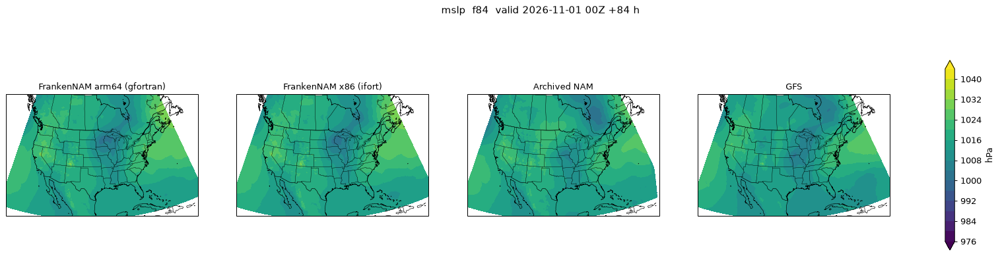
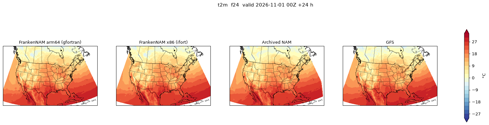

# Graviton (arm64, gfortran + OpenMPI) port of NPS + NEMS.x + UPP

Status, 4 Nov 2026: **the whole FrankenNAM stack builds and runs on AWS Graviton (aarch64) with
gfortran 13.3 + OpenMPI 4.1.6 from Ubuntu 24.04 apt**, with the same library pins as Phase 0 and
ESMF 7.1.0r (no move to 8.x). The 2026-11-01 00Z case ran 84 h on one c8g.8xlarge Spot node
(restarts off, 43 GB peak, $2.35) and differs from the x86 run by roundoff growing to a few
tenths of hPa/K at f84; recommendation at the end: make arm64 the default runner.
Artefacts: `s3://nam-recast-617711905691/build/2026-11-04-arm64/` (exec + MANIFEST + logs +
acceptance summary), `runner/bundle-20261104-arm64.tar`, `cases/2026110100/recast-arm64/`
(GRIB2 + logs), `cases/2026110100/figs-arm64/`. The sections below record what changed, what broke, the acceptance
results, timing/memory/cost against the x86 Phase 0 numbers, the arm-vs-x86-vs-NAM comparison and
the recommendation. Build box: c8g.8xlarge on-demand (32 Graviton4 / Neoverse-V2 cores, 64 GB),
`deploy/05-graviton-box.sh`; binaries are compiled with `-mcpu=neoverse-v1` so they also run on
Graviton3 (c7g/m7g).

## How to build / run (what is new)

- `build/versions.sh` picks `TOOLCHAIN=gnu` on aarch64 (`intel` on x86_64; override with
  `TOOLCHAIN=gnu` on x86 to test the GNU path). `build/env.sh` exports `CC/FC/MPIFC`, the
  GCC >= 10 relaxations (`GNU_LEGACY_FFLAGS`) and `ARCH_FLAGS=-mcpu=neoverse-v1` for it.
- `build/toolchain.gnu.sh` (apt: gfortran-13, openmpi-bin, libopenmpi-dev, ...) replaces
  `toolchain.sh` on the GNU path; `build/build_all.sh` chooses.
- `build/nems/configure.nems.awsarm.gnu`, `build/nps/configure.nps_awsarm_gnu_{dmpar,serial}`:
  the GNU configure files; `build_upp.sh` passes the GNU flags on the make command line.
- `run/recast.sh` picks Intel MPI or OpenMPI by what is installed (`mpi_cmd`), `run/runner.sh`
  has `NO_RESTART=1` (RESTMIN past the run, no f00 restart, no last restart) and `S3SUB`,
  `run/bundle.sh` makes the runner tar, `deploy/04-run-case.sh ARCH=arm64` launches a c8g Spot
  runner from it.

## Flag mapping (WCOSS2 Intel -> gfortran)

| Intel (WCOSS2 / Phase 0) | gfortran | Note |
|---|---|---|
| `-init=zero` | `-finit-local-zero` | NEMS relies on zeroed locals; also added to NPS (see ungrib below) |
| `-fp-model precise` / `strict` / `source` | nothing (`-O3`/`-O2`, **no `-ffast-math`**) | gfortran never reassociates or flushes denormals without -ffast-math; FMA contraction is on by default on both compilers |
| `-r8` | `-fdefault-real-8 -fdefault-double-8` | keeps DOUBLE PRECISION at 8 bytes, as `-r8` does |
| `-convert big_endian` | `-fconvert=big-endian` | |
| `-assume byterecl` | default | RECL in bytes |
| `-fpp` / `-free` / `-fixed` / `-FR` | `-cpp` / `-ffree-form` / `-ffixed-form` | UPP's makefile hardcodes `FREE=-FR`, overridden |
| `-qopenmp -auto` | `-fopenmp` | |
| `-traceback -g` | `-fbacktrace -g` | |
| `-march=core-avx2 -mtune=core-avx2` | `-mcpu=neoverse-v1` | Graviton3 ISA (SVE); runs on c7g/m7g/c8g/m8g |
| (none) | `-fallow-argument-mismatch -fallow-invalid-boz -fno-range-check -ffree-line-length-none` | GCC >= 10 rejects the MPI buffer type/rank mismatches a 2017 code is full of |
| debug: `-ftrapuv -fpe0 -check all` | `-O0 -g -fcheck=all,no-array-temps -finit-real=snan -ffpe-trap=invalid,zero,overflow` | `DEBUG=on` in the NEMS configure; `array-temps` only prints warnings |

## What broke and how it was fixed (every patch is in `build/patches/`, first line = why)

### ESMF 7.1.0r (kept; no 8.x needed)
Three new patches on top of the Phase 0 ones (`esmf-01` Sacado std::min/max and `esmf-02`
Intel-only explicit instantiation still apply/are harmless):
1. `esmf-03-gfortran-conf-stddef.patch`: `build_config/Linux.gfortran.default/ESMC_Conf.h`
   typedefs `size_t` without `<stddef.h>`; GCC 13's libstdc++ no longer includes it
   transitively, so every C++ file failed.
2. `esmf-04-aarch64-pointer-size.patch`: `ESMC_POINTER_SIZE` is derived from the ABI string
   macro (`Sx86_64_small`, `Sia64_64`, ...); on aarch64 `common.mk` leaves the plain `S64`, which
   the header does not know, and `ESMF_FortranWordsize` fails. Defined for `S64` (8 bytes).
3. `esmf-05-mpi3-removed-functions.patch`: OpenMPI 4.x no longer declares the MPI-1 functions
   removed in MPI-3.0 (`MPI_Address`, `MPI_Type_struct`, `MPI_UB`, `MPI_Attr_get`); Intel MPI still
   does, which is why Phase 0 never saw it. Only two compiled files use them: Zoltan's
   `par_bisect.c` (bisector struct type, rewritten with `MPI_Get_address` /
   `MPI_Type_create_struct` / `MPI_Type_create_resized`, same extent) and `ESMCI_VMKernel.C`
   (`MPI_Attr_get` -> `MPI_Comm_get_attr`). MPICH 4.2 from apt was checked as the alternative the
   brief allows: its `mpi.h` lacks the same symbols, so the patch is needed either way and OpenMPI
   stays.
Flags: `ESMF_COMPILER=gfortran ESMF_COMM=openmpi ESMF_ABI=64`,
`ESMF_CXXCOMPILEOPTS="-std=gnu++11 -Wno-narrowing -Wno-register"` (same two C++17 problems as
icpx in Phase 0), `ESMF_F90COMPILEOPTS` = the GCC relaxations. Build time 173 s on 32 cores
(x86 oneAPI: 289 s).

### NEMS / NMMB
- `nems-01-barrier-before-finalize.patch` kept (Phase 0; harmless under OpenMPI).
- `nems-02-co2hc-parameter-array-section.patch`: `co2hc.f` (IDEA/WAM physics, compiled into
  libphys but never called by the NMM core) passes `xvic0(51)`, an element of a PARAMETER array,
  to `splin2`'s explicit-shape dummy through an INTERFACE block; gfortran treats an element of a
  named constant as a scalar constant and rejects the rank mismatch even with
  `-fallow-argument-mismatch`. `xvic0(51:)` is the same sequence.
- Configure: `F77 = mpif90 ...` had to be defined. `atmos/nmm/makefile` compiles the
  `n_*.f` GFS-definition modules with `$(F77)`, which no WCOSS2 configure defines;
  `n_module_gfs_mpi_def.f` includes `mpif.h`, and ifort found it through setvars' `CPATH`.
- `nems-03-solver-my-domain-moves-init.patch` (found by reading the smoke run's stderr, which
  x86 never printed): the solver internal state's `MY_DOMAIN_MOVES` is only extracted inside the
  `I_AM_A_NEST` block of `SOLVER_INITIALIZE`, so for the parent domain it is an **uninitialised
  component of the allocated internal state**. ifort/x86 happened to read it as `.FALSE.`;
  gfortran/aarch64 reads a nonzero pattern as `.TRUE.`, and `SOLVER_RUN` then calls
  `ESMF_AttributeGet('MOVE_NOW')` every timestep on an attribute nobody sets
  (`ESMF_RC_ATTR_NOTSET` = 57; 20,496 `ERROR: Extract the MOVE_NOW flag` lines in a 3 h run,
  732 steps x 28 ranks). `MOVE_NOW` is preset `.FALSE.` right before that call and nothing else
  reads the flag for a parent, so the forecast was not affected (verified: the history of a smoke
  run with the fix is bit-identical to the one without, see the acceptance table). The flag is
  now initialised to `.FALSE.` and overridden for nests as before.
- Everything else compiled with warnings only (type/rank mismatches downgraded by
  `-fallow-argument-mismatch`). NEMS.x links in about 4 min of wall time on 32 cores (x86: 160 s).

### NPS
- `nps-01-edition-num-g2-gbytec.patch`: ungrib's `edition_num` read the GRIB discipline and
  edition bytes with `gbyte()`, which resolves to **w3nco's integer-word unpacker**; that routine
  assumes big-endian word layout and returns the reserved bytes (0) on this little-endian
  machine, so every GFS file was treated as neither GRIB1 nor GRIB2 and ungrib wrote nothing. g2's
  `g2_gbytec` is byte based and endian independent (WPS made the same change). Open question:
  the x86 binary links the same `gbyte_` and worked; not investigated further because the fix is
  right regardless, and the x86 box stays stopped.
- `-finit-local-zero` added to all NPS compiles (Intel's NPS flags did not have `-init=zero`):
  with the edition fixed, ungrib found all 696 fields of a GFS file, matched them against the
  Vtable, stored them, and still wrote no intermediate file ("Data not found"). `-O0` does not
  change that; `-finit-local-zero` does, so an uninitialised local in the ungrib output path is
  involved (ifort's stack happened to hold zero). `-Wmaybe-uninitialized` points only at
  `earth_radius` (rd_grib2), `iskip` and `gribsize` (GRIB1 code); the exact variable was not
  pinned down within this brief.
- Serial `ungribs`/`metgrid_serial`, dmpar `geogrid/ungrib/metgrid/nemsinterp` otherwise build
  unchanged (150 s).

### UPP
- `uppgnu-01-timef.patch` (GNU path only): `WRFPOST.f` times its phases with `timef()`, an Intel
  libifport portability routine gfortran lacks; a `system_clock` replacement with the same
  semantics (seconds since the first call, REAL(8)). `ncep_post` and `nam_post0` then link
  (97 s).

### Libraries
All 21 NCEPLIBS/netCDF/HDF5/jasper/png/zlib builds went through with gfortran unchanged apart
from the generic GNU flags (`-fcommon` for the C, the mismatch relaxations for the Fortran);
the stack without ESMF took about 4 min.

### UPP, second problem (found by the smoke-test post)
- `uppgnu-02-null-pointer-size.patch`: `gengrb2msg` takes `size()` of the POINTER components
  `level2`, `scale_fact_fixed_sfc2`, ... of `param_t`, which are `=> null()` for parameters whose
  `post_avblflds.xml` entry lacks them. `size()` of a disassociated pointer is undefined; ifort's
  zeroed descriptor returns 0 and the code relies on it, gfortran dereferences it and `ncep_post`
  segfaults (`grib2_module.f:704`, rank 13, after the CIN/PLPL/LTNG fields). A null-safe
  `psize()` generic replaces the calls (GNU path only).

## Acceptance on the build box (c8g.8xlarge, 32 cores, `run/smoke.sh`)

| Check | arm64 result | x86 Phase 0 |
|---|---|---|
| NPS, 84 h of GFS: ungrib / metgrid / nemsinterp | 351 / 467 / 511 s | 380 / 380 / 479 s |
| nemsinterp IC and bocos vs the x86 files | not bit-identical: median relative difference 1e-7 (IC) to 1e-6 (bocos); the largest absolute differences are 0.52 Pa in the pressure records (~1e5 Pa) and 3.6 in one boco.0000 record; 305 of 488 IC records differ (`run/cmp_nemsio.py`) | - |
| 3 h smoke, TDFI, 4x7 + 1x4, run 1 / run 2 | **829 s / 844 s** (exit 0) | 969 s |
| history files run 1 vs run 2 (`cmp`) | **bit-identical** (f00 and f03, 4.86 GB each, and the .ctl files) | not tested |
| 3 h smoke, run 3 with the `nems-03` binary | 832 s, 0 `MOVE_NOW` errors, history **bit-identical to run 1**: the fix changes nothing numerically (the 84 h validation run used the binary without it) | - |
| node memory peak during the smoke (`free`, 30 s) | 43.1 GB used | ~48 GB flat (84 h run) |
| max RSS of a rank (time -v, mpirun tree) | 1.65 GB | 2.2 GB |
| UPP on the smoke output (16 tasks) | **15 s (f00) / 16 s (f03)** after `uppgnu-02`; 1189 / 1199 GRIB2 messages, BGDAWP 475 / 500 MB (x86: 475 / 500 MB) | 21 s / file |
| `wgrib2 -stats` PRMSL | f00: mean 1012.1, min 975.8, max 1038.8 hPa; f03: mean 1012.4, min 970.8, max 1046.0 hPa; no undefined points | f84 range 969.7-1062.1 hPa |
| 1 h run, hourly history, no filter, **trap build B**: the same flags plus `-finit-local-zero` (integers/logicals zero, reals still sNaN) | **completes: exit 0, 1288 s (21.5 min at -O0 with bounds checks), f00 and f01 history written, no floating-point trap, no runtime check failure**, node peak 42.0 GB. So the dynamics, physics and I/O of the first hour never operate on an uninitialised real; what the production build's `-finit-local-zero` papers over is integer/logical state, in the write component (trap build A) and in `MY_DOMAIN_MOVES` (nems-03). | - |
| 1 h run, hourly history, no filter, **trap build A** (exactly `-O0 -g -fcheck=all -finit-real=snan -ffpe-trap=invalid,zero,overflow`) | no floating-point trap; the run aborts 17 s in, while the write (quilt) tasks write the f00 history: `NEMSIO_WRITEREC` returns an error on a 2-D integer record and `module_WRITE_GRID_COMP.F90:4100` prints "Failed to write output to file! Aborting!" (504 MB of the 4.86 GB file written). Nothing in the dynamics/physics had run yet. The write path therefore relies on zero-initialised locals (the brief's trap flags leave integers/logicals uninitialised); a second variant with integers zeroed (`DEBUG_EXTRA=-finit-local-zero`, reals still sNaN) is reported below. | 258 s (optimised) |

A trap of its own: the 150 GB build-box disk filled up during the acceptance runs (the 84 h NPS
intermediates are 83 GB: ungrib 26, metgrid 38, nemsinterp streams 19). The symptoms were a UPP
rank dying with SIGBUS (exit 135) and a GRIB2 file 186 KB short, which looked like an OpenMPI
MPI-IO (OMPIO) problem until `df` was checked; with space freed both OMPIO and ROMIO write the
files correctly. Delete `ungrib/`, `metgrid_bc/` and `nemsinterp_bc/` after `recast.sh nps`,
or give the box 300 GB as the x86 one had.

Note on the smoke timing: gfortran on Graviton4 is **13 % faster** than ifort on the c7a
(Genoa) build box for this run, the opposite of the 10-25 % slowdown the plan assumed.

## Validation run (84 h, c8g.8xlarge Spot, restarts off)

`ARCH=arm64 SUBNET=<us-west-2d> deploy/04-run-case.sh`: one c8g.8xlarge Spot instance
(i-03401ec837ccd27c9, us-west-2d, $0.466/h) booted from the stock arm64 Ubuntu AMI, installed
the OpenMPI runtime from apt, unpacked `runner/bundle-20261104-arm64.tar` (9.3 GB) and was
integrating 45 s after `runner.sh` started (16:42:53 UTC). Same layout as Phase 0 (4x7 compute
+ 1x4 write = 32 ranks, one per core, TDFI, 3-hourly history), **no restart files at all**
(`minutes_restart 100800`, `rst_out_00 false`, `write_last_restart false`), history kept on
the node, UPP with 16 ranks after the forecast, GRIB2 + logs to
`s3://nam-recast-617711905691/cases/2026110100/recast-arm64/`.

A first attempt died at start: `minutes_restart 99999` is not a multiple of the 25 s time step
("Timestep of this domain does not divide evenly into the restart interval"); 100800 min
(70 days) is. Cost of the lesson: 3 min of Spot.

| | arm64 c8g.8xlarge Spot (this run) | x86 r7a.8xlarge Spot (Phase 0) |
|---|---|---|
| node memory in use (`free`, 1 min) | peak **43.3 GB**, flat (no restart gather) | 48 GB flat, 70-77 GB at restart writes, peak 77.4 |
| max RSS of one rank (`time -v`) | 1.81 GB | 3.7 GB |
| forecast wall time, 84 h, 12,096 steps, TDFI | **16,811 s = 200.1 s per forecast hour** | 15,905 s = 189.3 s per forecast hour |
| UPP, 29 files, 16 tasks, after the forecast | 785 s (27 s per file) | 634 s (20-31 s per file) |
| runner boot to computing (bundle from S3 + apt OpenMPI) | 48 s | ~45 s |
| Spot price paid | $0.466/h x 5.0 h = **$2.3** | $0.82/h x 4.65 h = $3.80 |

So the arm64 run is **5.7 % slower per forecast hour** than the x86 run although the 3 h smoke
on the same hardware was 13 % faster than the x86 smoke; the smoke is dominated by the filter
and initialisation, the long run by the radiation steps (the x86 run was also on a different
node class, r7a). Both are single measurements; per run the arm64 node is still 40 % cheaper
because it is cheaper per hour and needs no 256 GB node.

Two artefacts of the run that are not model problems:
- The runner wrote `FAILED` although NEMS.x exited 0 and UPP returned 0 with all 29 files:
  `recast.sh` returned 2 with "line 228: unexpected EOF while looking for matching quote" after
  the forecast stage, because I had replaced `/opt/nam/work/run/recast.sh` on the node (scp of the
  MPI-IO fix) while the running shell was still reading the old file. bash reads scripts
  incrementally; never overwrite a script that is executing. The marker in S3 was replaced by a
  `DONE` with that note.
- OpenMPI prints one `help-opal-shmem-mmap` warning at finalize (`unlink /dev/shm/vader_segment...
  No such file or directory`, 31 more suppressed): teardown noise after the barrier-before-finalize
  patch, no effect on the output.

## arm vs x86 vs archived NAM (2026-11-01 00Z, `run/compare.py`)

Same method as `docs/phase0-case-2026110100.md`: everything on a 0.25 deg grid, statistics over
CONUS land points, archived NAM as the reference; "closer to NAM" = lowest RMSE among arm, x86
and GFS. The x86 columns reproduce the Phase 0 table to the last digit, which also validates
the new in-Python geolocation of the rotated B grid. Figures: `docs/figs/case-2026110100-arm64/`
(`<field>_f<lead>.png`, panels arm | x86 | NAM | GFS; 6 h and total precipitation; a 3x3
`nine_panel_f48.png`), also in `s3://nam-recast-617711905691/cases/2026110100/figs-arm64/`.

| Field | Lead | RMSE arm vs x86 | bias arm vs x86 | RMSE arm vs NAM | bias arm vs NAM | RMSE x86 vs NAM | bias x86 vs NAM | RMSE GFS vs NAM | bias GFS vs NAM | closer to NAM |
|---|---|---|---|---|---|---|---|---|---|---|
| mslp (hPa) | f00 | 0.00 | +0.00 | 0.82 | -0.53 | 0.82 | -0.53 | 0.86 | -0.56 | arm |
| z500 (dam) | f00 | 0.00 | +0.00 | 0.67 | -0.58 | 0.67 | -0.58 | 0.52 | -0.38 | GFS |
| t2m (K) | f00 | 0.00 | +0.00 | 1.15 | -0.14 | 1.15 | -0.14 | 1.36 | -0.31 | arm |
| wspd10 (m/s) | f00 | 0.00 | +0.00 | 1.10 | +0.45 | 1.10 | +0.45 | 1.22 | +0.58 | x86 |
| mslp (hPa) | f24 | 0.08 | +0.00 | 0.91 | -0.02 | 0.91 | -0.02 | 1.72 | -0.89 | x86 |
| z500 (dam) | f24 | 0.03 | +0.00 | 0.70 | -0.21 | 0.70 | -0.21 | 1.47 | -0.76 | x86 |
| t2m (K) | f24 | 0.15 | +0.00 | 1.52 | +0.31 | 1.53 | +0.31 | 1.88 | -0.11 | arm |
| wspd10 (m/s) | f24 | 0.14 | +0.00 | 0.91 | +0.03 | 0.92 | +0.03 | 1.77 | +0.31 | arm |
| mslp (hPa) | f48 | 0.14 | -0.01 | 1.43 | +0.47 | 1.46 | +0.48 | 1.73 | -0.51 | arm |
| z500 (dam) | f48 | 0.11 | -0.00 | 1.17 | +0.08 | 1.16 | +0.08 | 1.62 | -0.12 | x86 |
| t2m (K) | f48 | 0.28 | -0.01 | 1.41 | +0.34 | 1.41 | +0.35 | 1.99 | +0.15 | x86 |
| wspd10 (m/s) | f48 | 0.26 | +0.01 | 0.99 | +0.09 | 1.01 | +0.08 | 1.80 | +0.50 | arm |
| mslp (hPa) | f84 | 0.52 | -0.09 | 3.87 | -0.06 | 3.72 | +0.03 | 3.60 | -1.72 | GFS |
| z500 (dam) | f84 | 0.26 | -0.03 | 3.64 | -0.46 | 3.59 | -0.43 | 3.29 | +0.01 | GFS |
| t2m (K) | f84 | 0.66 | -0.02 | 2.64 | +0.10 | 2.64 | +0.12 | 3.52 | +1.50 | arm |
| wspd10 (m/s) | f84 | 0.56 | -0.01 | 1.34 | +0.01 | 1.26 | +0.03 | 1.35 | -0.29 | x86 |
| precip24h_0-24 (mm) | f24 | 0.74 | -0.00 | 6.41 | -0.62 | 6.39 | -0.62 | 6.61 | -0.59 | x86 |
| precip24h_24-48 (mm) | f48 | 2.03 | +0.01 | 5.16 | -0.48 | 5.11 | -0.48 | 6.77 | +0.09 | x86 |
| precip24h_60-84 (mm) | f84 | 5.94 | +0.18 | 9.57 | +0.20 | 8.66 | +0.02 | 9.72 | -0.25 | x86 |

What it says:
- **f00: the two builds are identical to the printed precision** (RMSE 0.000 hPa / 0.001 dam /
  0.00 K / 0.00 m/s): the same initial state from the same NPS output chain (the arm64 chain's
  own IC differed from the x86 IC by roundoff only, see above).
- **Divergence grows like roundoff through a chaotic model, not like a bug:** arm vs x86 is
  0.08 hPa / 0.03 dam / 0.15 K / 0.14 m/s at f24, 0.14 / 0.11 / 0.28 / 0.26 at f48 and
  0.52 hPa / 0.26 dam / 0.66 K / 0.56 m/s at f84, with biases of +-0.01 or less until f84
  (-0.09 hPa MSLP, -0.03 dam, -0.02 K): 5-25 % of the x86-vs-NAM RMSE at every lead. 24 h
  precipitation differs more (0.7, 2.0 and 5.9 mm RMSE for days 1-3; day 3 is 70 % of the
  x86-vs-NAM 8.7 mm) because convective cells displace under tiny perturbations; the bias stays
  within 0.2 mm.
- **Against the archived NAM the two builds are interchangeable:** at f24 and f48 the arm and
  x86 RMSEs agree to 0.03 or better; at f84 arm is 0.15 hPa / 0.05 dam / 0.08 m/s worse and
  equal on 2 m T, differences of the size of the arm-vs-x86 spread itself. The Phase 0 verdict
  (closer to the NAM than the GFS through f48, mixed at f84) is unchanged.
- The figures show no visible difference between the arm and x86 panels at f24/f48; at f84 the
  western-Atlantic low and the Great Lakes trough differ in detail (the same regions where
  Phase 0 noted the recast departing from both the NAM and the GFS).
- Nothing here points at an endianness, kind or initialisation problem: those show up at f00
  or as a bias, and there is neither.

## Cost

Prices confirmed from the pricing API / Spot history on 4 Nov 2026 (us-west-2):
c8g.8xlarge on-demand $1.27616/h, c8g.8xlarge Spot in us-west-2d $0.4655-0.4662/h
(2a-2c were $0.53); Phase 0's r7a.8xlarge Spot was $0.82/h.

| Item | Hours | Rate | Cost |
|---|---|---|---|
| arm build box c8g.8xlarge on-demand, 14:54-19:49 UTC (toolchain + 22 libraries + NPS/NEMS/UPP + debugging, NPS stage, 3 smokes, 2 trap runs, UPP tests, bundles) | 4.92 | $1.276 | $6.28 |
| of which idle by mistake (a marker that was never written kept the box up ~2.4 h after the trap run ended) | 2.4 | $1.276 | ~$3.1 |
| arm build box again for the comparison + final bundle, 21:45-21:57 UTC | 0.2 | $1.276 | $0.26 |
| Spot runner attempt 1, c8g.8xlarge 2d (aborted at start: restart interval not a multiple of the time step) | 0.05 | $0.466 | $0.02 |
| Spot runner attempt 2, c8g.8xlarge 2d, 16:42-21:45 UTC, 84 h + UPP | 5.05 | $0.466 | $2.35 |
| EBS (150 GB gp3 box ~6 h, 300 GB gp3 + 6000 IOPS/500 MB/s runner ~5 h), S3 PUTs | | | ~$0.5 |
| **Total for this brief** | | | **~$9.4 (budget $15)** |

Cost per 84 h run, compute only: **~$2.3 on c8g.8xlarge Spot** against $3.80 on the Phase 0
r7a.8xlarge Spot ($0.82/h x 4.65 h); the saving is mostly the node class (restarts off lets
a 64 GB c-class node do it), the arm64 Spot price itself is 15-20 % under c7a's.

Ongoing: the arm64 runner bundle (9.3 GB) and the arm64 GRIB2 set (~15 GB) add ~$0.55/month in S3.

## Recommendation

**Make arm64 (c8g.8xlarge Spot, restarts off) the default runner**, keeping the x86 path
buildable as the fallback. Reasons:
- Numerically it is the same model: bit-reproducible run to run, identical to x86 at f00,
  roundoff-sized divergence afterwards, same skill against the archived NAM.
- Operationally it is simpler and cheaper: no Intel licence/runtime to ship (the runner is stock
  Ubuntu + apt OpenMPI + a 9.3 GB bundle), $2.3 per 84 h run against $3.8, and the restarts-off
  configuration fits 64 GB with 20 GB to spare, so c-class nodes in eight Spot pools
  (c7g/c8g x four zones) are available instead of r-class in four.
- Speed is a wash: 13 % faster on the 3 h smoke, 6 % slower per forecast hour over 84 h (one
  measurement each, different x86 node classes); UPP 27 s vs 20-31 s per file.
What to keep in mind:
- Restarts off means a Spot reclaim costs a $2.3 rerun; at 00Z/12Z cadence with the measured
  4.7 h run time the window is long. If reclaims turn out frequent, m8g.8xlarge (128 GB,
  $0.53/h) brings restarts back for +$0.3 per run; the runner already supports both modes.
- Three latent upstream bugs surfaced only because gfortran does not zero memory the way ifort
  happened to (ungrib output path, write component integer state, `MY_DOMAIN_MOVES`); two are
  patched, the ungrib one is mitigated with `-finit-local-zero`. A future compiler or
  allocator change on x86 could expose the same bugs there; the patches apply to both builds.
- The per-hour pace should be re-measured on the first few scheduled cycles (c7g vs c8g, zone),
  and the hindcast arms of Phase 1 should all run on the same architecture so that arm-vs-x86
  spread does not enter the scorecard.
- Not done in this brief: ESMF 8 (not needed), nest/moving-nest code paths (never exercised by
  the parent-only configuration), `nam_land_utilities` and the BUFR sounding tools (Phase 0
  skip list), a second case.
