# Phase 0 case: 2026-11-01 00Z recast vs archived NAM vs GFS

The recast is NMMB/NEMS from the NAM v4.2.11 source, built on AWS (Intel oneAPI 2024.2). It is a
cold start from GFS f000 at the cycle time, with GFS f003-f084 lateral boundaries, parent 12 km
domain only, no data assimilation, TDFI digital filter, and physics exactly as in `nam_configfile`.
The archived NAM is the operational run of the same cycle (`awphysNN`, grid 218). The GFS is
the staged `pgrb2.0p25`.

All three are interpolated to 0.25 deg, 20-60N, 130-60W (`run/compare.py`). The statistics are
for CONUS land points (GFS land mask, 25-50N, 125-67W), with the archived NAM as the reference.
"Closer to NAM" means the lower RMSE.

## Is the recast closer to the NAM than the GFS is?

| Field | Lead | RMSE recast | bias recast | RMSE GFS | bias GFS | closer to NAM |
|---|---|---|---|---|---|---|
| mslp (hPa) | f24 | 0.91 | -0.02 | 1.72 | -0.89 | recast |
| z500 (dam) | f24 | 0.70 | -0.21 | 1.47 | -0.76 | recast |
| t2m (K) | f24 | 1.53 | +0.31 | 1.88 | -0.11 | recast |
| wspd10 (m/s) | f24 | 0.92 | +0.03 | 1.77 | +0.31 | recast |
| mslp (hPa) | f48 | 1.46 | +0.48 | 1.73 | -0.51 | recast |
| z500 (dam) | f48 | 1.16 | +0.08 | 1.62 | -0.12 | recast |
| t2m (K) | f48 | 1.41 | +0.35 | 1.99 | +0.15 | recast |
| wspd10 (m/s) | f48 | 1.01 | +0.08 | 1.80 | +0.50 | recast |
| mslp (hPa) | f84 | 3.72 | +0.03 | 3.60 | -1.72 | GFS |
| z500 (dam) | f84 | 3.59 | -0.43 | 3.29 | +0.01 | GFS |
| t2m (K) | f84 | 2.64 | +0.12 | 3.52 | +1.50 | recast |
| wspd10 (m/s) | f84 | 1.26 | +0.03 | 1.35 | -0.29 | recast |
| precip24h_0-24 (mm) | f24 | 6.39 | -0.62 | 6.61 | -0.59 | recast |
| precip24h_24-48 (mm) | f48 | 5.11 | -0.48 | 6.77 | +0.09 | recast |
| precip24h_60-84 (mm) | f84 | 8.66 | +0.02 | 9.72 | -0.25 | recast |

**Mostly yes, on this one case.**
- **f24 and f48:** the recast is closer to the archived NAM than the GFS is in all eight
  comparisons. RMSE is roughly half the GFS's for MSLP, 500 hPa height and 10 m wind at f24, and
  25-45% lower at f48.
- **f84:** the recast is still closer for 2 m temperature and 10 m wind: the NAM's
  near-surface character, with no 1.5 K warm bias like the GFS. For MSLP and 500 hPa height the
  GFS is slightly closer (3.60 vs 3.72 hPa, 3.29 vs 3.59 dam). By then the synoptic pattern is set
  by the boundaries and by error growth, and both the recast and the archived NAM have drifted
  from the GFS.
- **24 h precipitation:** the recast is closer in all three windows. The margin is small for
  the first day (6.4 vs 6.6 mm) and larger for 24-48 h (5.1 vs 6.8 mm).

One cycle is an anecdote, not a score. The Phase 1 hindcast set is what can say this with any
confidence, and it must verify against observations as well as against the archive.

## Figures

Each panel row is recast | archived NAM | GFS. The figures are also in
`s3://nam-recast-617711905691/cases/2026110100/figs/`.

| Field | f24 | f48 | f84 |
|---|---|---|---|
| MSLP | 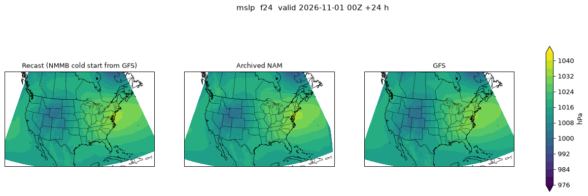 | 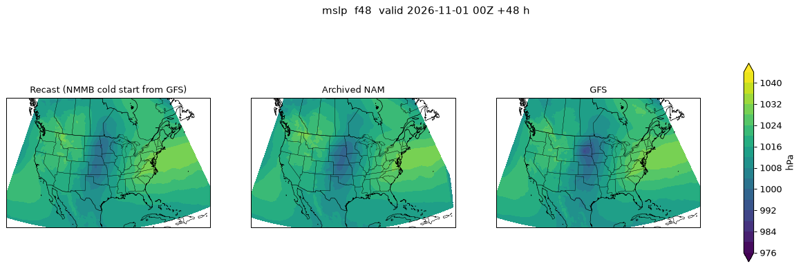 | 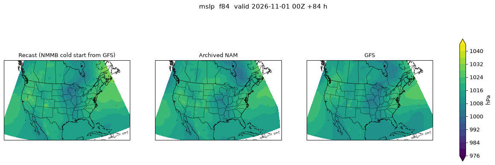 |
| 500 hPa height | 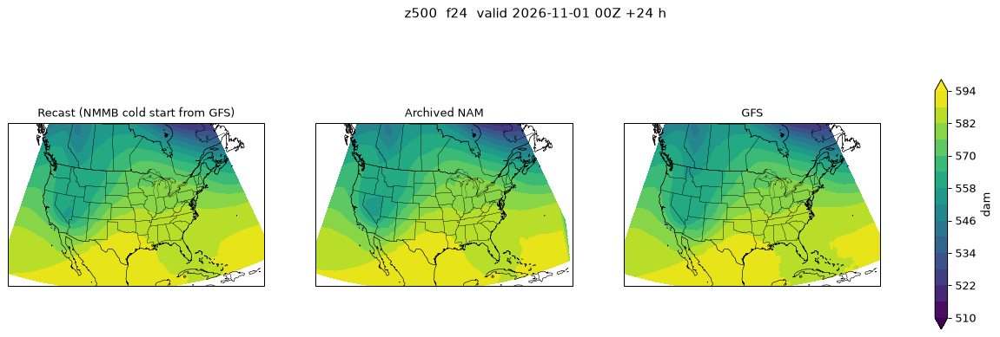 | 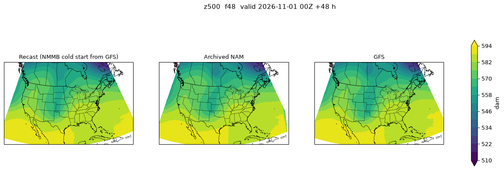 | 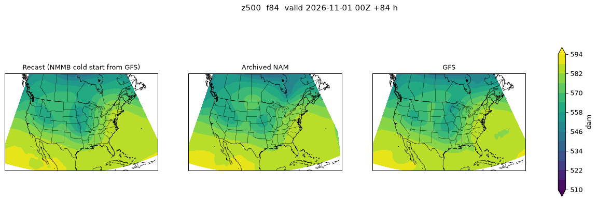 |
| 2 m temperature | 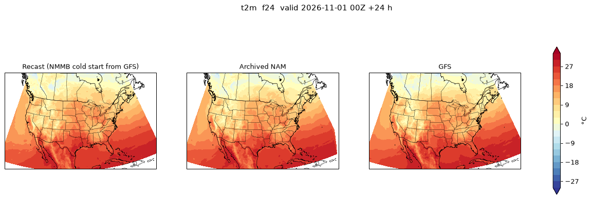 |  | 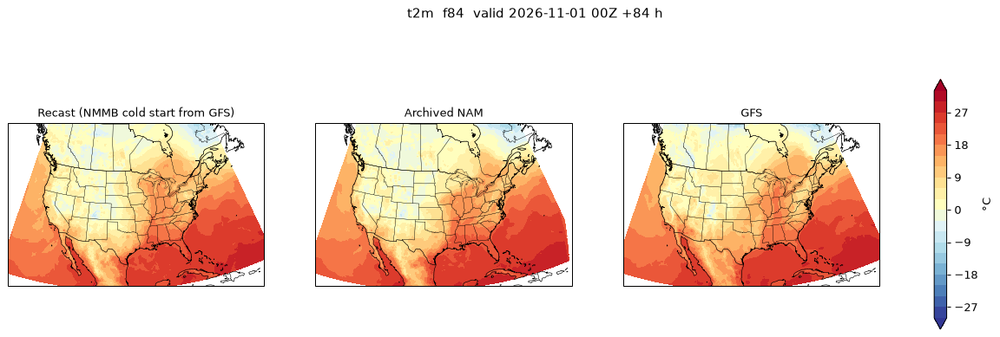 |
| 10 m wind speed | 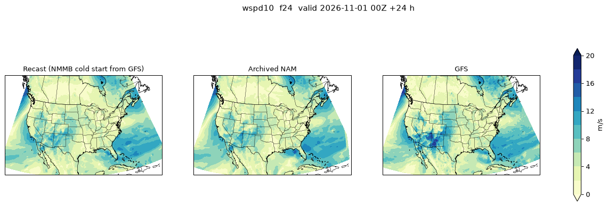 | 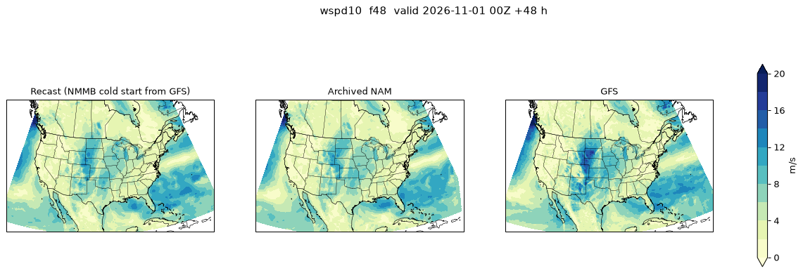 | 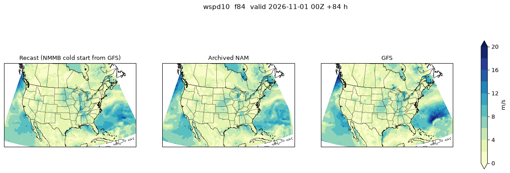 |
| 700 hPa RH | 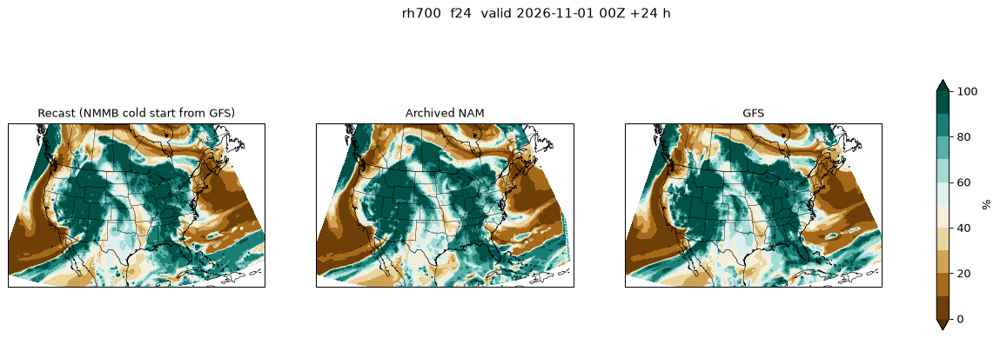 | 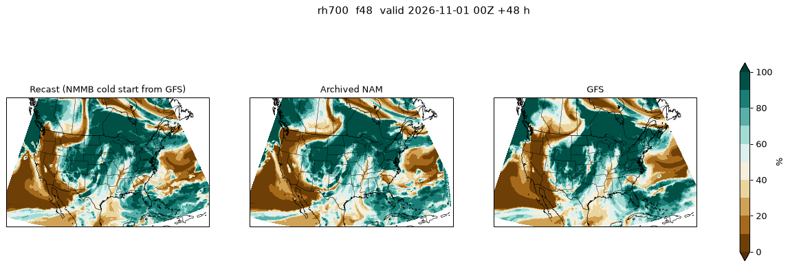 | 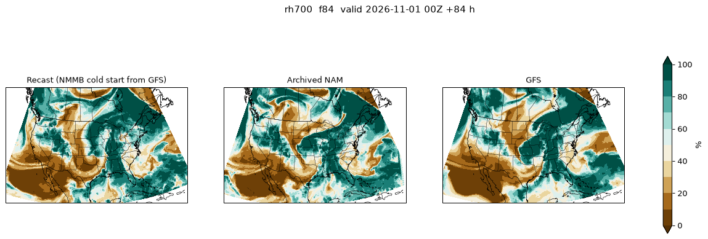 |
| 6 h precip ending | 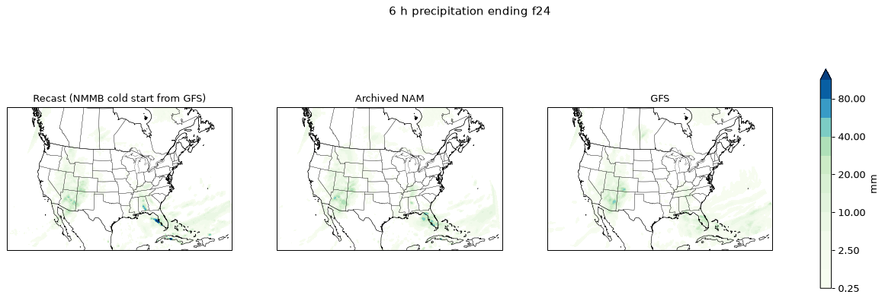 | 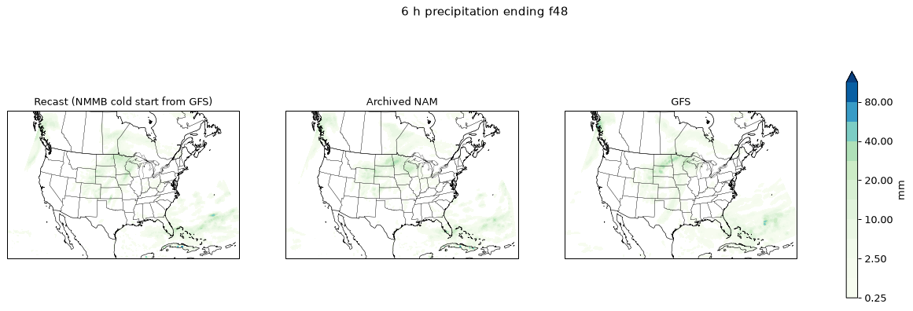 | 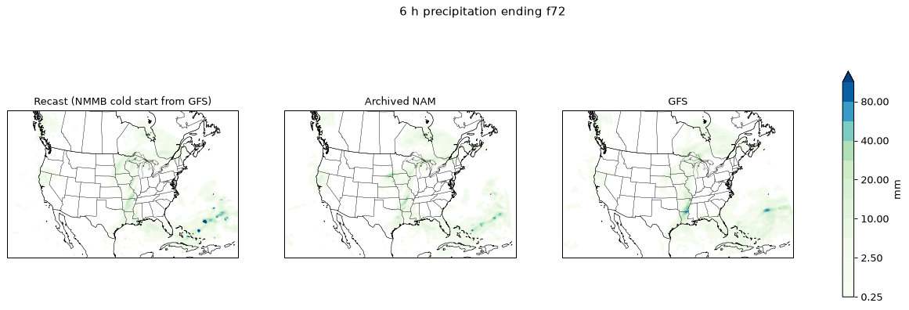 (f72) |

Total precipitation, f00-f84: 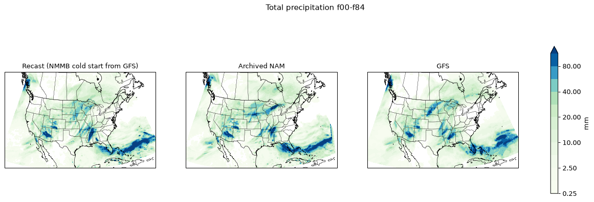

What the figures show:
- The large-scale patterns agree across all three through f48.
- In the 84 h totals, the recast reproduces the NAM's Gulf of Mexico / Florida band, its
  Pacific Northwest coastal maximum, and its southern Plains cells.
- The recast's Upper Midwest band is weaker and more broken than the NAM's.
- By f84 the recast's MSLP pattern over the Great Lakes and the western Atlantic differs from
  both the NAM and the GFS.

## Caveats

- The recast starts from the GFS analysis. The operational NAM started from its own 6 h
  catch-up DA cycle (radar, lightning, radiances) and cycled land states. In
  the first 12 h, differences are therefore mostly the initial condition, not the model.
- History output is 3-hourly. 6 h precipitation comes from differences of the 12 h buckets
  (00Z cycle, `nhrs_prec 12`), the same as the archive.
- Reflectivity was skipped; 700 hPa RH is shown instead.
- RMSE is computed on a 0.25 deg grid after bilinear interpolation. It penalises the
  12 km detail of both NAMs against each other equally.
- Acceptance check: the f84 PRMSL range is 969.7-1062.1 hPa with no undefined points. The
  maximum is at 72.1N, 36.4W on the Greenland ice sheet, an artefact of reducing pressure to sea
  level over 3 km of ice. It lies outside the comparison box; grid 218 does not reach Greenland.
