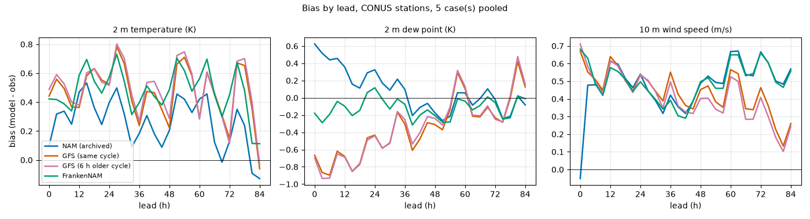
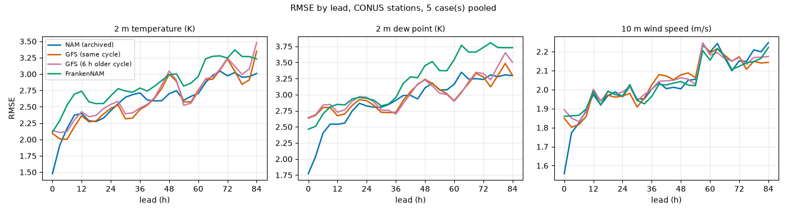
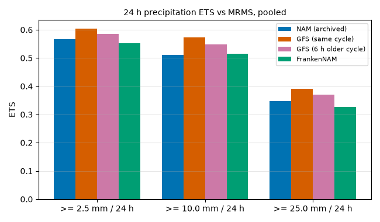
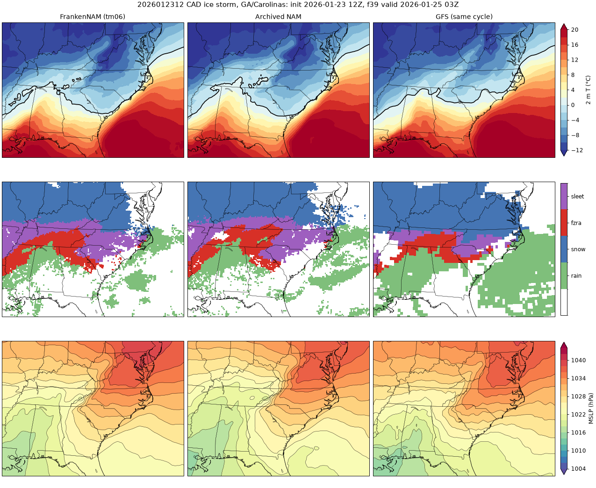
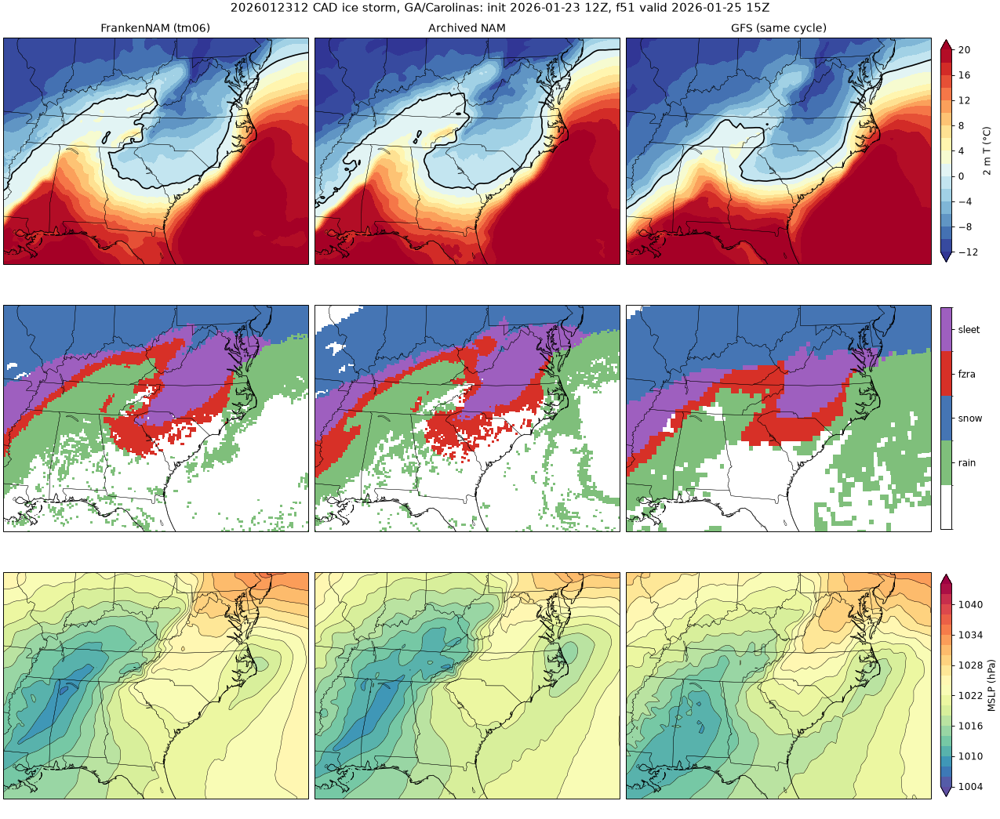
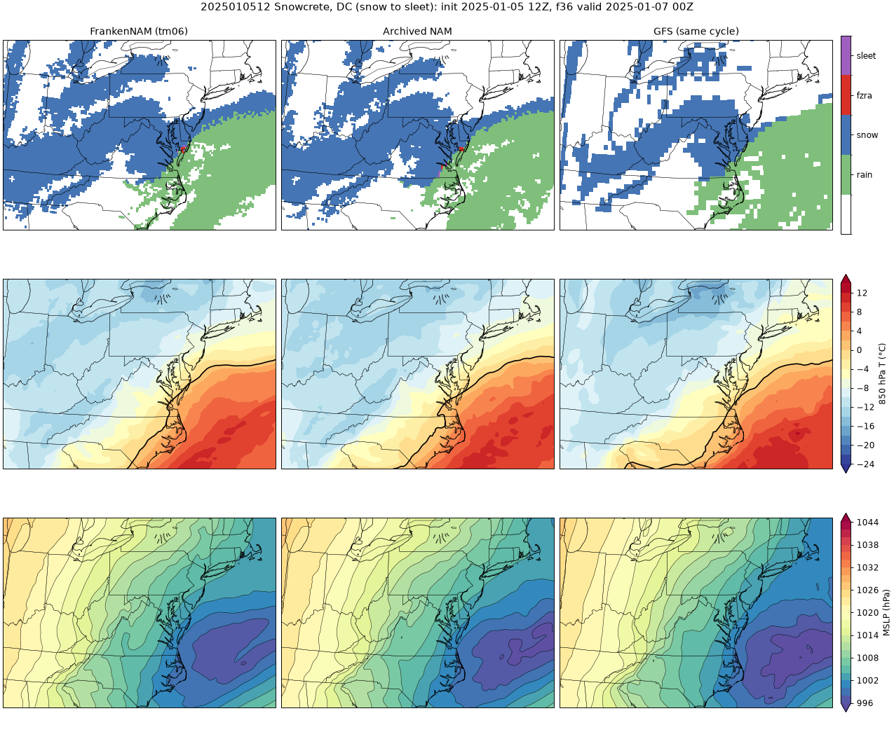
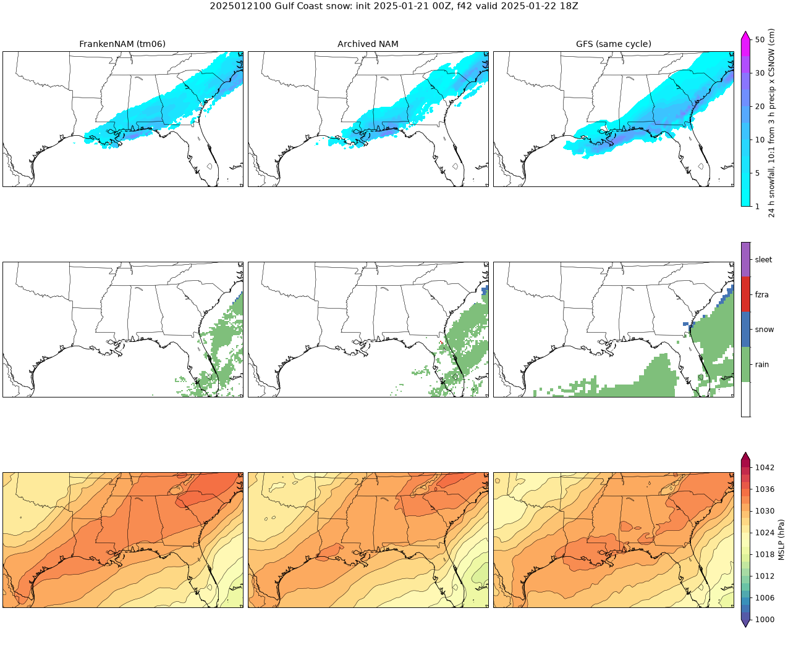
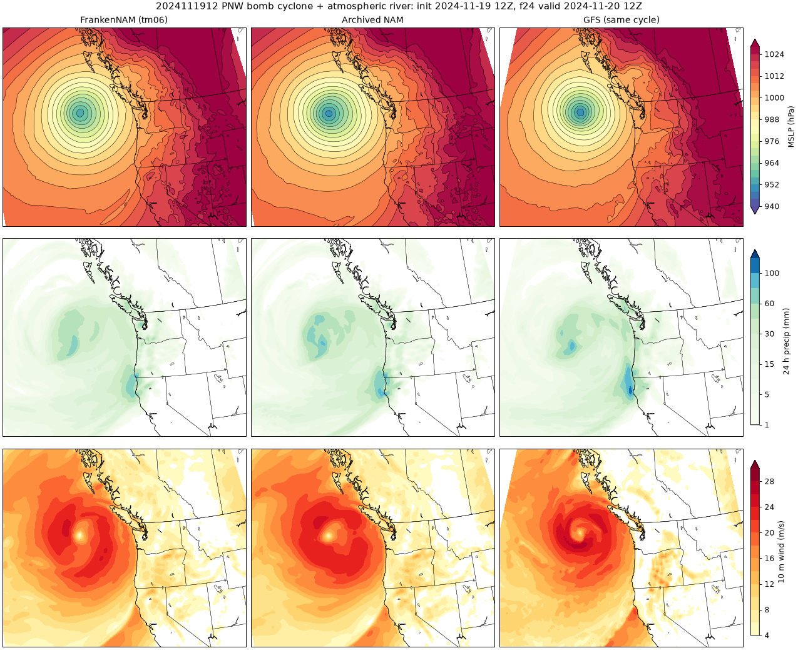

# FrankenNAM Phase 1 hindcast: fidelity scorecard (6 Nov 2026)

FrankenNAM is the NAM's 12 km parent (NMMB physics, the operational configuration) started from the GFS
analysis 6 h before the product cycle with a 6 h NAM spin-up and the NAM's own Noah soil state (tm06, see
`docs/tm06-design.md`). The Phase 1 gate (`docs/phase1-plan.md`) is **fidelity to the archived NAM**, with
the GFS alongside for context. This page is the verdict on the cases we could afford to run, written plainly.

## One-page summary

**What ran.** Five tm06 cases: Phase 0 (2026-11-01 00Z), the CAD ice storm (2026-01-23 12Z), Snowcrete
(2025-01-05 12Z), Gulf Coast snow (2025-01-21 00Z) and the PNW bomb cyclone (2024-11-19 12Z); one
analysis-start reference arm (Snowcrete). **Not run:** Plains severe/blizzard (2025-03-14 12Z), the lake-effect
case (2025-12-29 12Z) and the CAD analysis-start arm. US-west-2 Graviton Spot capacity reclaimed nine runners in
16 hours (four times on the Snowcrete tm06 job alone, which finally ran on-demand), and the losses
used the money for those three runs (cost section). Five cases, not seven; no significance tests; these are
weather-picked cases, not a sample.

**Gate verdict.**

| Gate item | Result |
|---|---|
| Statistical: 2 m T RMSE within 0.1 K of the NAM (12-84 h, CONUS, pooled) | **FAIL**: 2.95 vs 2.70 K (+0.24); bias +0.49 vs +0.26 K (same sign) |
| Statistical: 2 m Td RMSE within 0.1 K | **FAIL**: 3.34 vs 3.04 K (+0.30); bias -0.11 vs +0.01 K (sign differs; both near zero) |
| Statistical: 10 m wind RMSE within 0.1 m/s | **PASS**: 2.06 vs 2.08 m/s; bias +0.49 vs +0.50 |
| Statistical: 24 h precipitation ETS within 0.03 of the NAM (2.5/10/25 mm) | **PASS**: 0.552/0.515/0.326 vs 0.566/0.510/0.347 (-0.014/+0.005/-0.021) |
| Statistical: not worse than the 6 h older GFS by more than the margins | **FAIL** for T/Td (+0.18/+0.26 K) and ETS (-0.034/-0.034/-0.045); wind passes |
| Feature fidelity (four cases with runs) | **PASS** for CAD, Snowcrete and Gulf snow; **PARTIAL** for PNW (low 4-6 hPa weaker, mountain precipitation drier); Plains and lake effect **not run** |

**Why T and Td fail: a cold-start defect, found and traced in this hindcast.** FrankenNAM starts with almost no
ice in the soil. Over cold land (0-10 cm soil below -2 °C) the archived NAM keeps 58-66 % of the 0-10 cm soil
water and 32-58 % of the 10-40 cm water frozen; FrankenNAM's f00 has 1-6 % and <1 %, and the analysis-start
arm's true initial state has **0.000** (table below). The soil then refreezes over days, releasing latent heat, and
the 0-10 cm soil runs 1-2 K warmer than the NAM's by f48. The size of the 2 m T penalty follows the amount of
frozen ground: +0.04 K on the autumn Phase 0 case (4.5 k cold points), +0.12 PNW (23 k), +0.17 Snowcrete,
+0.39 Gulf and +0.42 CAD (71-80 k), with the warm departure concentrated in the Midwest and Plains (+0.72 /
+0.86 K bias against the NAM's +0.18 / +0.58). nemsinterp has a Flerchinger cold-start routine that should
produce frozen water from soil temperature and the model reads `sh2o` from the IC, so the ice is lost somewhere
between `NMM_SH2O` and the model's first step; the fix (Phase 2, before anything else) is to read the `sh2o`
records of an `input_domain_01_nemsio` with `run/cmp_nemsio.py`, then either repair that path or seed the
NAM's liquid soil water (SOILL) through metgrid alongside SOILW. Until then the winter scores are a model of
"the NAM with thawed soil", not the NAM.

**What holds.** Against the archived NAM grid to grid, FrankenNAM is far closer than the GFS on every case at
f24/f48 (MSLP 0.8-1.6 vs 1.5-2.7 hPa; 10 m wind 0.5-1.0 vs 1.0-1.8 m/s; 2 m T 0.9-1.5 vs 1.8-3.0 K), wind
skill is the NAM's, precipitation skill is the NAM's within the margin, and the forecaster-facing features (the
CAD wedge, the freezing rain/sleet belts, the Gulf snow band, the PNW low's track) come out as the NAM drew
them. The precipitation shortfall against the GFS is the NAM's own (baseline scorecard: the NAM trailed the
GFS by 0.03-0.06 ETS on these cases); FrankenNAM inherits it. The honest public line stays: **an independent
second opinion with the NAM's physics, not a GFS-beater**, and after the frozen-soil fix a re-score of these
five cases (about $13 of reruns, no new staging) is the real Phase 1 verdict on T and Td.

**Reference arm (tm06 vs analysis start, Snowcrete only).** tm06 tracks the NAM better than the same-cycle
analysis start at every lead despite 6 h less information: 2 m T RMSE against the NAM 0.9-1.5 K vs 1.4-2.0 K,
warm bias +0.1 to +0.5 vs about +0.7 K, MSLP 0.9/1.1 vs 1.2/1.4 hPa at f24/f48. Against stations tm06 is
also better (2 m T 2.56 vs 2.67 K, Td 2.71 vs 2.92 K). The soil-moisture departure explains little of it (the
spatial correlation between each run's 2 m T departure and its 0-10 cm soil-moisture departure is 0.0-0.2): the
gain comes mostly from the NAM-like spin-up and the NAM soil temperature, not the soil moisture. Both arms
carry the frozen-soil defect (the anl arm starts fully thawed), which is part of the anl arm's larger warm bias.
One case; the CAD reference arm was lost to Spot reclaims and is the first rerun after the fix.

## 1. Statistical fidelity against observations

Method and observations as in `docs/baseline-scorecard.md` (ASOS/AWOS with lapse-rate correction, MRMS
Pass2 24 h QPE in 0.25° boxes, SNOTEL, ASOS present weather). Full auto-generated tables and figures:
`docs/phase1-obs-scorecard.md` (five cases, NAM | GFS | GFS 6 h older | FrankenNAM). Gate tables:
`verify/results/phase1/gate.md` (`python -m verify.hindcast gate --obs-tag phase1-obs --ref-tag phase1-ref`).

Pooled 12-84 h, CONUS, five cases (RMSE / bias):

| variable | n | FrankenNAM | Archived NAM | GFS 6 h older | GFS same cycle | FrankenNAM − NAM |
|---|---|---|---|---|---|---|
| 2 m T (K) | 278,098 | 2.947 / +0.49 | 2.703 / +0.26 | 2.766 / +0.49 | 2.715 / +0.47 | **+0.243** |
| 2 m Td (K) | 277,203 | 3.335 / -0.11 | 3.037 / +0.01 | 3.071 / -0.26 | 3.033 / -0.28 | **+0.299** |
| 10 m wind (m/s) | 275,432 | 2.064 / +0.49 | 2.075 / +0.50 | 2.077 / +0.39 | 2.076 / +0.43 | -0.011 |

24 h precipitation against MRMS, ETS (frequency bias):

| threshold | FrankenNAM | Archived NAM | GFS 6 h older | GFS same cycle | FrankenNAM − NAM |
|---|---|---|---|---|---|
| ≥ 2.5 mm | 0.552 (1.08) | 0.566 (1.11) | 0.585 (1.09) | 0.604 (1.11) | -0.014 |
| ≥ 10 mm | 0.515 (0.96) | 0.510 (1.03) | 0.549 (0.98) | 0.573 (1.01) | +0.005 |
| ≥ 25 mm | 0.326 (0.92) | 0.347 (0.98) | 0.371 (0.90) | 0.390 (0.95) | -0.021 |

Per case, 12-84 h (FrankenNAM − NAM RMSE; bias FrankenNAM vs NAM in brackets):

| case | 2 m T (K) | 2 m Td (K) | wind (m/s) | ETS diff 2.5 / 10 / 25 mm |
|---|---|---|---|---|
| `2026110100` Phase 0 (autumn) | +0.04 (-0.43 vs -0.16) | +0.16 (-0.73 vs -0.12) | -0.05 | +0.00 / +0.02 / +0.00 |
| `2026012312` CAD ice storm | +0.42 (+1.60 vs +1.14) | +0.48 (+1.14 vs +0.85) | +0.04 | -0.04 / +0.02 / -0.07 |
| `2025010512` Snowcrete | +0.17 (+0.27 vs -0.09) | -0.06 (-0.10 vs -0.36) | +0.01 | -0.01 / -0.05 / -0.06 |
| `2025012100` Gulf snow | +0.39 (+1.28 vs +0.57) | +0.43 (+0.32 vs +0.08) | +0.05 | -0.01 / -0.11 / -0.02 |
| `2024111912` PNW bomb | +0.12 (-0.24 vs -0.15) | +0.38 (-1.16 vs -0.38) | -0.10 | -0.02 / -0.01 / +0.02 |

By lead (RMSE FrankenNAM / NAM): 2 m T 2.58/2.28 (3-24 h), 2.81/2.63 (27-48 h), 3.16/2.88 (51-84 h); Td
2.82/2.58, 3.10/2.93, 3.64/3.23; wind 1.93/1.91, 2.00/2.00, 2.14/2.17. By region (12-84 h, 2 m T RMSE / bias):
FrankenNAM is close to the NAM in the SE (2.45/+0.13 vs 2.32/+0.08) and in the West (3.43/+0.32 vs
3.32/+0.17 for the NAM, 3.51/+0.91 for the GFS: the NAM's small western bias is inherited), and furthest
from it in the Midwest (3.05/+0.72 vs 2.49/+0.18) and NE (2.93/+0.67 vs 2.84/+0.55), where the ground was
frozen. The PNW case's dew point is 0.8 K drier than the NAM; that case had little frozen ground, so a second
cause may sit there (open).

P-type against ASOS present weather, event regions (share of observed station-hours matched):

| case | lead | n | NAM | GFS | GFS 6 h older | FrankenNAM |
|---|---|---|---|---|---|---|
| CAD | 3-36 h | 123 | 25.2 % | 52.0 % | 58.5 % | 32.5 % |
| CAD | 39-84 h | 1133 | 38.6 % | 42.9 % | 42.4 % | 39.3 % |
| Snowcrete | 3-36 h | 528 | 76.1 % | 80.1 % | 78.4 % | 79.0 % |
| Snowcrete | 39-84 h | 233 | 51.9 % | 49.8 % | 45.5 % | 53.2 % |
| Gulf snow | 3-36 h | 488 | 44.9 % | 78.1 % | 77.5 % | 51.8 % |

FrankenNAM's p-type behaves like the NAM's (the same tendency to put sleet and freezing rain where snow was
observed in the CAD and Gulf cases), slightly better than the archive in every row. SNOTEL, PNW case: ratio of
model to observed 24 h precipitation 0.73 (NAM 0.87, GFS 0.71), correlation 0.69 (NAM 0.69).

## 2. Grid-to-grid fidelity to the archived NAM

0.25° boxes over the CONUS mask, model minus archived NAM, RMSE / bias (`verify/results/phase1/g2g.csv`,
`python -m verify.hindcast g2g`). FrankenNAM | GFS same cycle | GFS 6 h older.

| case | field | f24 | f48 | f84 |
|---|---|---|---|---|
| Phase 0 | MSLP (hPa) | **0.98** \| 1.69 \| 1.87 | **1.07** \| 1.75 \| 1.83 | **2.82** \| 3.44 \| 3.65 |
| | 2 m T (K) | **1.40** \| 1.83 \| 1.92 | **1.32** \| 2.00 \| 1.95 | **2.28** \| 3.40 \| 3.47 |
| | 10 m wind (m/s) | **0.98** \| 1.73 \| 1.82 | **0.83** \| 1.81 \| 1.88 | **1.14** \| 1.22 \| 1.47 |
| | Z500 (dam) | **0.57** \| 1.52 \| 1.48 | **0.86** \| 1.70 \| 1.60 | 3.31 \| 2.98 \| **2.95** |
| CAD | MSLP | **0.86** \| 1.54 \| 1.65 | **1.26** \| 2.52 \| 2.90 | **0.83** \| 3.43 \| 3.90 |
| | 2 m T | **1.24** (+0.33) \| 1.99 \| 2.02 | **1.47** (+0.72) \| 2.78 \| 2.82 | **1.13** (+0.57) \| 2.54 \| 2.47 |
| | 10 m wind | **0.53** \| 0.99 \| 1.00 | **0.67** \| 1.29 \| 1.37 | **0.55** \| 1.47 \| 1.46 |
| Snowcrete | MSLP | **0.90** \| 2.23 \| 2.36 | **1.07** \| 2.09 \| 1.86 | **2.04** \| 3.08 \| 4.02 |
| | 2 m T | **1.29** (+0.48) \| 2.35 \| 2.34 | **1.54** (+0.34) \| 2.97 \| 2.95 | **1.35** (+0.46) \| 2.45 \| 2.48 |
| | 10 m wind | **0.46** \| 0.91 \| 0.91 | **0.53** \| 1.13 \| 1.09 | **0.88** \| 1.30 \| 1.39 |
| Gulf snow | MSLP | **0.80** \| 1.75 \| 1.88 | **1.19** \| 2.16 \| 2.24 | **1.42** \| 3.36 \| 4.02 |
| | 2 m T | **0.88** (+0.45) \| 1.91 \| 1.93 | **1.26** (+0.55) \| 2.31 \| 2.35 | **2.14** (+1.36) \| 3.06 \| 3.23 |
| | 10 m wind | **0.55** \| 1.28 \| 1.36 | **0.68** \| 1.19 \| 1.22 | **0.63** \| 1.16 \| 1.23 |
| PNW bomb | MSLP | **1.12** \| 2.03 \| 2.23 | **1.62** \| 2.66 \| 2.68 | **2.35** \| 2.49 \| 2.66 |
| | 2 m T | **0.91** \| 2.22 \| 2.28 | **0.97** \| 2.66 \| 2.70 | **1.51** \| 2.15 \| 2.25 |
| | 10 m wind | **0.69** \| 1.58 \| 1.59 | **0.89** \| 1.37 \| 1.43 | **0.98** \| 1.51 \| 1.52 |

24 h precipitation (mm, RMSE vs the NAM, windows ending f24/f48/f84): FrankenNAM is closest in 11 of 15
case-windows; the exceptions are the PNW first day (7.6 vs GFS 5.4 mm: the deepening low and its rain shield),
the Phase 0 first day (7.2 vs 7.0 mm) and two windows with under 1 mm RMSE for every model. The 2 m T column shows the frozen-soil warm drift in the three
winter cases (bias +0.3 to +1.4 K against the NAM) while every other field stays within roughly half the GFS's
distance from the NAM.

## 3. Feature fidelity (9-panels)

Panels: FrankenNAM | archived NAM | GFS (same cycle), at two valid times per case chosen **from the archived
NAM alone** (the event metric's peak in the event box and the best other time ≥ 12 h away, so the choice does
not favour FrankenNAM). Areas below are in the event box (`verify/results/phase1/feature_metrics.txt`).

**CAD ice storm (2026-01-23 12Z), f39 and f51: PASS.** The damming high (1036-1040 hPa ridge down the
Piedmont), the sub-freezing wedge into the Carolinas and the freezing-rain/sleet belt from Alabama to North
Carolina are the NAM's. Sub-freezing 2 m area 389 k km² vs the NAM's 397 k (GFS 341 k) at f39, 270 k vs 264 k at
f51; freezing rain + sleet 279 k vs 295 k (GFS 172 k) and 238 k vs 215 k. The wedge persists to f51 as in the NAM.
Difference: FrankenNAM's freezing-rain band sits slightly farther west (more over Alabama/Georgia, less over
Upstate South Carolina).

MRMS composite reflectivity | FrankenNAM | NAM at the NAM's peak hour (f39, 2026-01-25 03Z): the two models
draw the same shield (strongest over Tennessee, northern Alabama/Georgia and the Carolinas, the same weak
echoes offshore); MRMS has the echoes over Tennessee/Kentucky to Virginia and Mississippi/Alabama with little
over Georgia and the Carolinas, an error FrankenNAM shares with the NAM almost pixel for pixel.

**Snowcrete (2025-01-05 12Z), f21 and f36: PASS.** The snow-to-sleet transition around DC: at f21 (06 Jan 09Z)
both have the sleet pocket over northern Virginia/DC with snow to the north and the 850 hPa 0 °C line in the
same place; FrankenNAM has more sleet (63 k km² vs 41 k) and less freezing rain (15 k vs 45 k), and the sleet edge a
little farther north. By f36 both are all snow (166 k vs 174 k km²), so the timing of the transition back matches.
Against ASOS p-type FrankenNAM scores 79 % / 53 % (early / late) against the NAM's 76 % / 52 %.

**Gulf Coast snow (2025-01-21 00Z), f30 and f42: PASS.** The snow band from the Texas coast through
Louisiana to the Carolinas, and the narrow sleet/freezing-rain strip on its southern edge along the
Florida panhandle and Georgia coast, match the NAM; FrankenNAM is somewhat heavier (24 h 10:1 snowfall max
29.8 cm vs 23.6, area > 5 cm 255 k km² vs 201 k; GFS 349 k).

**PNW bomb cyclone + atmospheric river (2024-11-19 12Z), f12 and f24: PARTIAL.** The low's track is the NAM's
to 0.2° (46.9 N 132.0 W vs 46.7 N 132.2 W at f12), but it is 6 hPa weaker at f12 (946.9 vs 941.0 hPa; GFS 940.9)
and 4 hPa weaker at f24 (954.2 vs 950.3), and the peak 10 m wind matches (29.2 vs 29.7 m/s). Starting from
the 6 h older GFS, FrankenNAM catches less of the explosive deepening. The coastal and Olympic/Cascade
precipitation maxima are in the NAM's places but weaker: SNOTEL ratio 0.73 vs the NAM's 0.87.

**Plains severe + blizzard, lake effect: not run** (cost section). The panel code, metrics and MRMS panels for
both are in `verify/hindcast.py` and were exercised with stand-in models; they run as soon as the products exist.

## 4. The reference arm: does tm06 track the NAM better than an analysis start, and why?

Snowcrete only (the CAD reference run was lost to two Spot reclaims). `verify/results/phase1/ref.csv`,
`python -m verify.hindcast ref --case 2025010512`, figure `figs/hindcast/ref_arms.png`.

Grid to grid against the archived NAM (0.25° CONUS land, RMSE / bias):

| lead | 2 m T tm06 | 2 m T anl | 2 m Td tm06 | 2 m Td anl | soil moisture 0-10 cm tm06 | anl |
|---|---|---|---|---|---|---|
| f00 | 1.47 / +0.21 | 1.98 / +0.81 | 2.04 / -0.21 | 2.37 / -0.76 | 0.038 / -0.019 | 0.068 / -0.045 |
| f12 | 0.94 / +0.26 | 1.45 / +0.75 | 2.10 / +0.38 | 2.16 / -0.20 | 0.045 | 0.078 |
| f24 | 1.29 / +0.48 | 1.69 / +0.70 | 1.54 / +0.45 | 1.83 / +0.30 | 0.046 | 0.079 |
| f48 | 1.54 / +0.34 | 1.86 / +0.72 | 1.57 / +0.26 | 1.94 / +0.23 | 0.044 | 0.076 |
| f72 | 1.33 / +0.31 | 1.74 / +0.50 | 1.56 / +0.25 | 1.94 / +0.15 | 0.040 | 0.073 |
| f84 | 1.35 / +0.46 | 1.46 / +0.67 | 1.94 / +0.48 | 1.94 / -0.11 | 0.037 | 0.072 |

Against stations (12-84 h): tm06 2 m T 2.56 / +0.27 K, anl 2.67 / +0.72, NAM 2.39 / -0.09; Td 2.71 vs 2.92
(NAM 2.77); wind equal; ETS 0.51/0.71/0.43 vs 0.49/0.74/0.44 (NAM 0.51/0.77/0.49).

Reading: **yes, tm06 tracks the NAM better than the analysis start**, at every lead, by 0.1-0.5 K in 2 m T
and 20-30 % in MSLP through f48; only the f84 MSLP favours the anl run (2.0 vs 1.3 hPa). **Why:** the NAM soil
moisture is not the main reason: tm06's 0-10 cm soil moisture is half as far from the NAM's as the anl run's
(0.04 vs 0.07 m³/m³), but the spatial correlation between either run's 2 m T departure and its soil-moisture
departure is only 0.0-0.2 at every lead. What separates them is the warm bias (+0.7 K for anl from f00 on vs
+0.2-0.5 for tm06) and its persistence: the anl run starts from the GFS soil temperature and a fully thawed soil
(frozen share 0.000), while tm06 starts from the NAM soil temperature and 6 h of NAM-physics boundary layer,
and its soil is equally thawed but begins refreezing 6 h earlier. Spin-up plus soil temperature, not soil
moisture, is the plausible split; the frozen-soil defect is a common term that one case cannot separate cleanly.
A second reference case (CAD) after the fix would answer it.

## 5. What broke, and what was fixed on the way

- **Spot reclaims:** nine runners lost in 16 h (m8g: 4, c8g: 5; 6 min to 3 h 45 min into a run). The m8g Spot
  placement score in us-west-2 was 1 of 10 (c8g/c7g/m7g 3); remaining jobs moved to c8g/c7g, and Snowcrete
  tm06 finally ran on-demand ($6.74). With restarts off a reclaim restarts the job from zero; Phase 2 needs the
  restart-resume path on 128 GB nodes, or on-demand for the live cycle.
- **Queue for two consumers:** the old pop rewrote the queue file (a read-modify-write race). Now each line is
  claimed by an S3 conditional put (`If-None-Match: *`) of `queue/hindcast.claims/NN`; six concurrent claims on
  a three-line test queue took each line exactly once. The relay now waits for fewer than two runners and
  worked end to end (a NOOP job chained through a t4g.nano relay). Held lines are claimed with a "HELD" body
  (lines 09 Plains and 10 lake effect are held; delete the claim objects to release them).
- **anl products:** `MODE=anl` now writes grid-218 products (3 h buckets, no clock shift; its f00 has 439
  records against 446, f03 452 and f06 454 as the archive) to `cases/<C>/recast-anl/products/`.
- **Env leak in chaining:** a tm06 job chained from an anl runner inherited `S3SUB=recast-anl` and wrote its
  logs/DONE there (products were right); moved, and `launch.sh --next` now drops the finished job's
  S3SUB/S3PROD/FHMAX/NOOP/POST_AFTER (45da52b).
- `ONDEMAND=1` crashed under `set -u` (empty array); fixed (4589386).
- A trap: a terminated Spot instance's request stays `active` for a minute or two and still counts against the
  64 vCPU quota; a laptop launch right after a termination is refused.
- The laptop lost its AWS endpoints for about an hour (19:05-20:10Z, 5 Nov); the coordinator relaunched
  Snowcrete tm06 meanwhile.

## 6. Cost

| Item | Hours | Cost |
|---|---|---|
| Chain/queue test (short anl job + 3 NOOP jobs + relays) | 0.6 | $0.35 |
| CAD tm06: m8g reclaimed (1.33 h), m8g reclaimed (0.1 h), c8g done (5.48 h) | 6.9 | $3.32 |
| Snowcrete tm06: m8g ×2 and c8g ×2 reclaimed (3.55 + 1.17 + 3.03 + 0.45 h), on-demand c8g done (5.28 h) | 13.5 | $10.85 |
| CAD anl: c8g reclaimed twice (1.1 + 0.45 h), not completed | 1.55 | $0.76 |
| Snowcrete anl: c8g done | 4.9 | $2.62 |
| Gulf tm06: c8g done | 5.35 | $2.51 |
| PNW tm06: c8g reclaimed (0.77 h), c8g done (5.43 h) | 6.2 | $3.32 |
| EBS gp3 300 GB, 6000 IOPS, 500 MB/s on every runner (~$0.073/h) | 39 | $2.85 |
| S3 copies, requests, verification reads to the laptop | | ~$0.2 |
| **Total** | | **≈ $26.8 against the $25 budget** |

Of that, **$6.0 of instance time (about $7 with volumes) went to runs that were reclaimed**, and $3.9 is the
on-demand premium on Snowcrete. The overrun is the EBS line, which the earlier per-run estimates ($2.60) left out: a completed c8g
run is $2.45 of instance plus about $0.40 of volume. Storage left: 15 GB of native UPP output and 1.8 GB of
products per run (the 165 GB of duplicate `grib2-all/` was deleted), about $1.9/month.

## 7. Next

1. Fix the frozen-soil cold start (read the IC's `sh2o`, repair `NMM_SH2O` or seed SOILL). This is the gate blocker.
2. Rerun the five tm06 cases and the two reference arms with the fix, then Plains and lake effect, on a
   restart-capable setup or on-demand for the long ones (≈ $25-30 at measured prices including EBS).
3. Look at the PNW dew-point dry bias separately (little frozen ground there).
