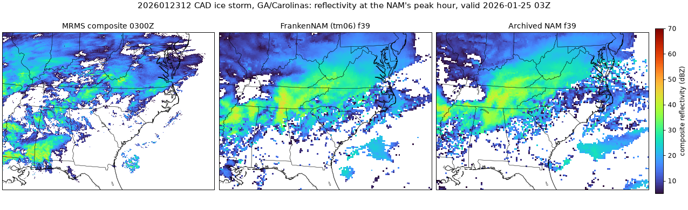
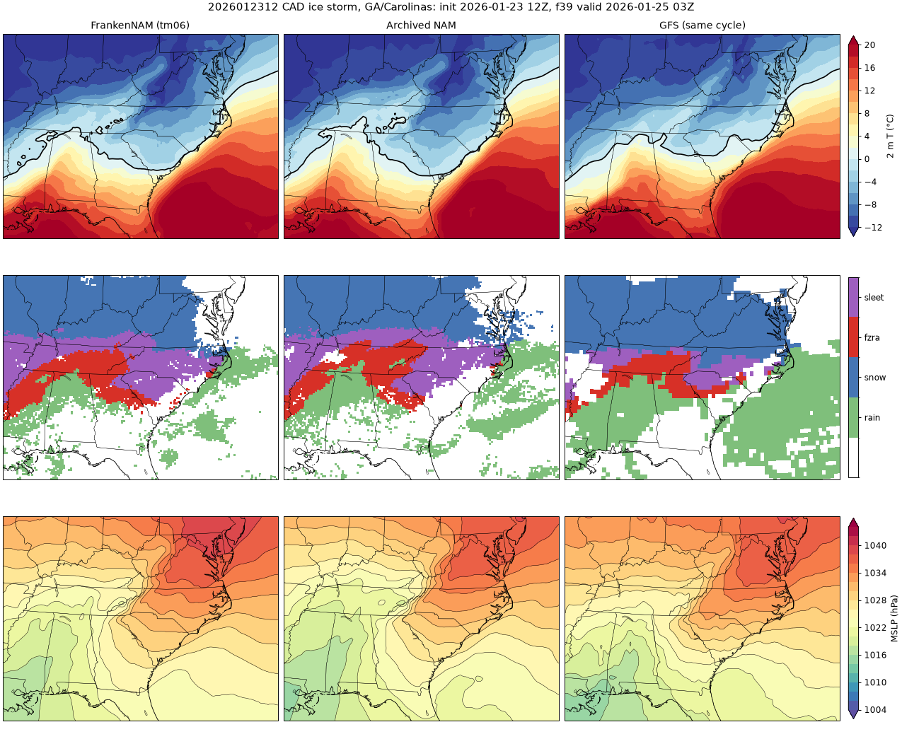
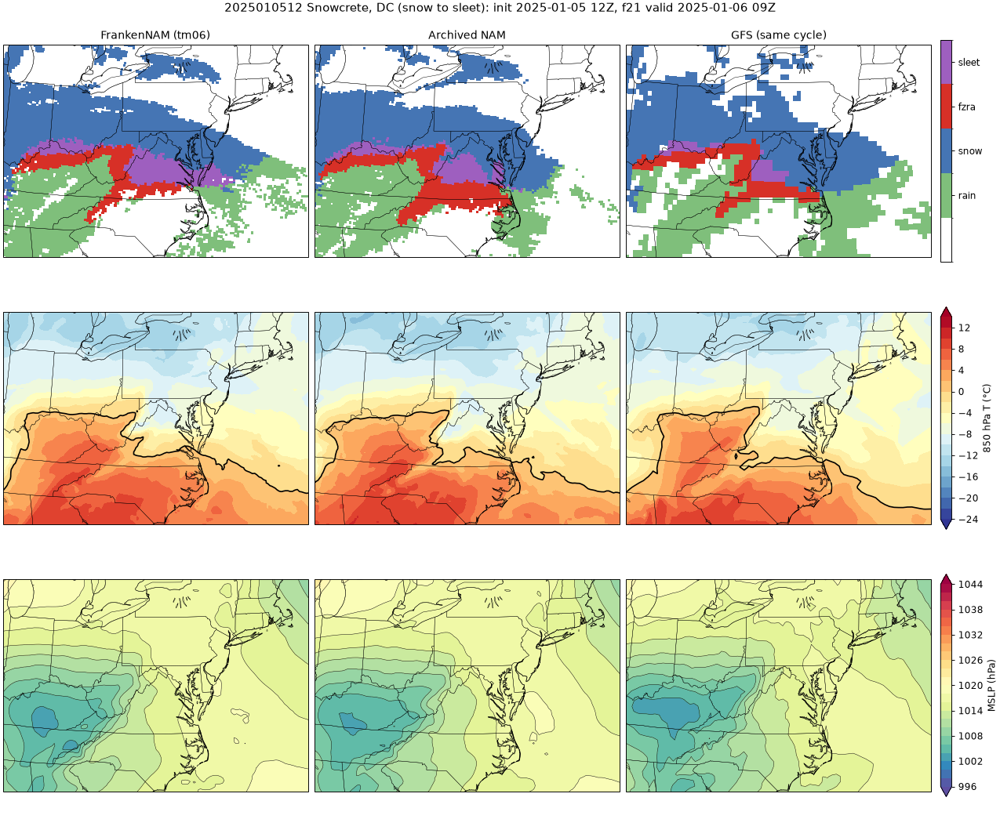
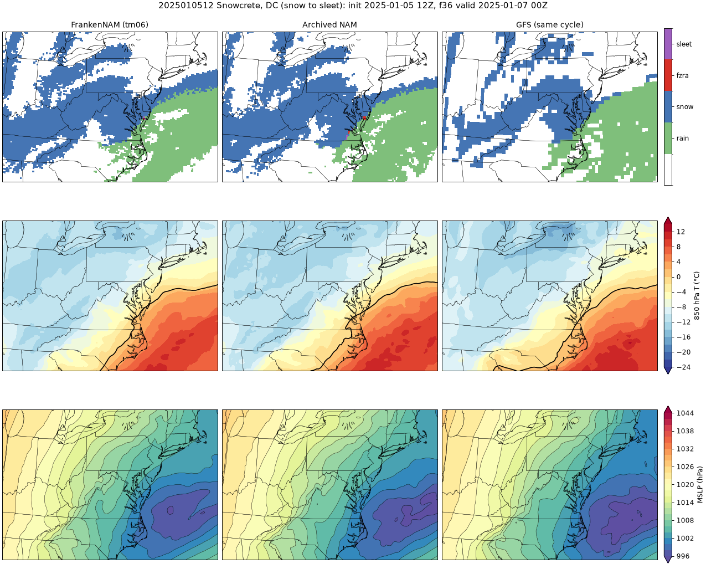
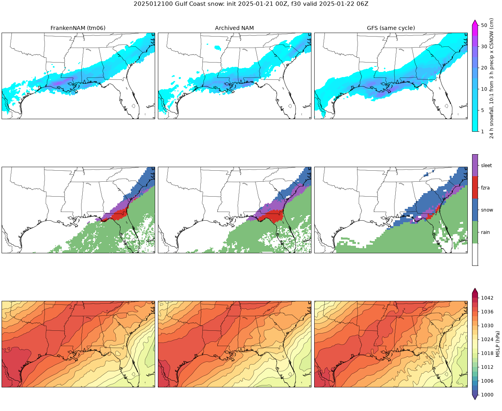
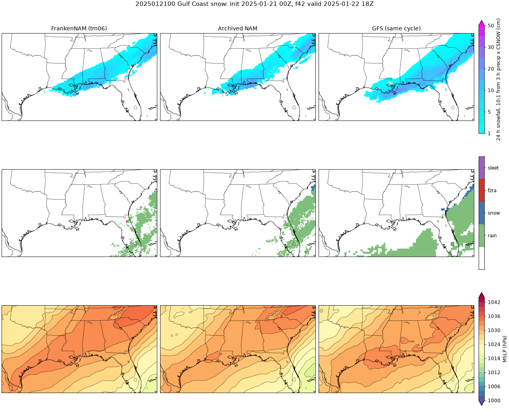
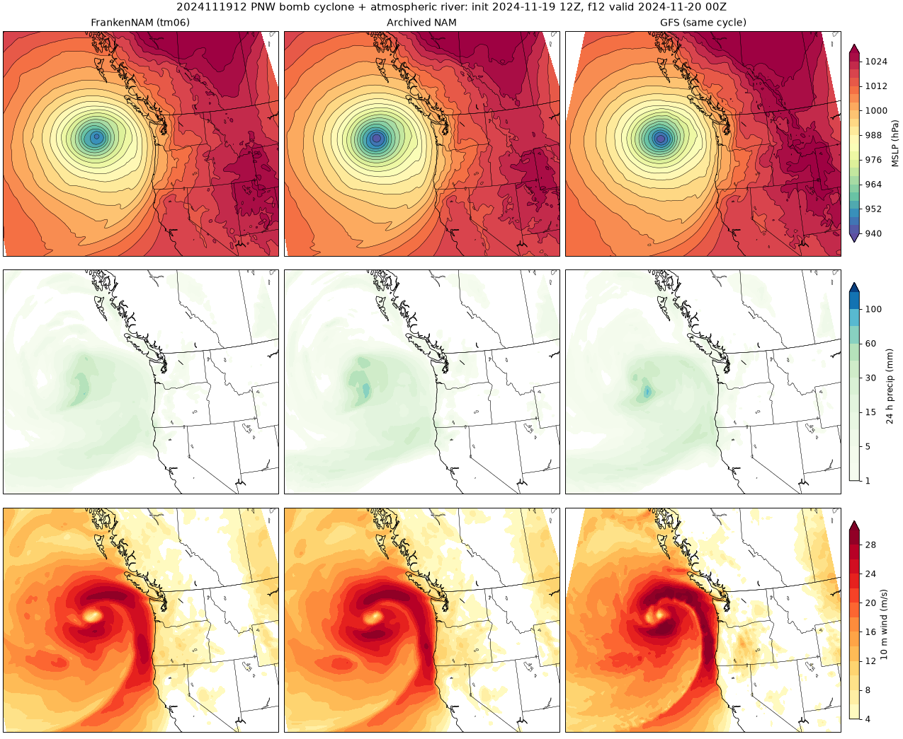

# FrankenNAM Phase 1 hindcast: fidelity scorecard, rerun with the cold-start soil-ice fix (7 Nov 2026)

This page replaces the 6 Nov scorecard (kept in git history, commit 1fa7642). That version failed the 2 m T and Td gate
on a cold-start defect: nemsinterp wrote total soil water into the initial `sh2o` records, so every run began with no
soil ice (patch `nps-02`, `docs/build-notes.md`). The five tm06 cases were rerun with the patched bundle
(`runner/bundle-20261106-tm06-arm64.tar`, same configuration, 90 h, c8g Spot); old products are kept in
`s3://nam-recast-617711905691/cases/<cycle>/pre-nps02/products/`. **Every number below is generated by
`python -m verify.scorecard_phase1b` from `verify/results/phase1*` (old) and `verify/results/phase1b*` (new);
nothing is hand-edited.** The gate is fidelity to the archived NAM; GFS is context.

## One-page summary

| Gate item (12-84 h, CONUS, five cases pooled) | Old (6 Nov) | New (nps-02) |
|---|---|---|
| 2 m T (K) RMSE minus NAM (margin 0.1) | +0.243, bias +0.49 vs +0.26: **FAIL** | +0.091, bias +0.23 vs +0.26: **PASS** |
| 2 m Td (K) RMSE minus NAM (margin 0.1) | +0.299, bias -0.11 vs +0.01: **FAIL** | +0.306, bias -0.48 vs +0.01: **FAIL** |
| 10 m wind (m/s) RMSE minus NAM (margin 0.1) | -0.011, bias +0.49 vs +0.50: **PASS** | -0.018, bias +0.47 vs +0.50: **PASS** |
| 24 h precip ETS >= 2.5 mm minus NAM (margin 0.03) | -0.014: **PASS** | -0.015: **PASS** |
| 24 h precip ETS >= 10.0 mm minus NAM (margin 0.03) | +0.005: **PASS** | +0.000: **PASS** |
| 24 h precip ETS >= 25.0 mm minus NAM (margin 0.03) | -0.021: **PASS** | -0.023: **PASS** |
| FrankenNAM minus GFS 6 h older RMSE (T / Td / wind; gate margin 0.1) | +0.181 / +0.264 / -0.013 | +0.029 / +0.271 / -0.020 |

**Reading.** The fix removes the 2 m T failure: the pooled RMSE gap to the NAM falls from the old value to the new one above, which is inside the 0.1 K margin, and the bias matches the NAM's. The Gulf snow case still carries the largest T gap, so a per-case failure remains there. **Td stays outside the margin** and is not helped by the fix: the new run is drier than the NAM (bias -0.48 vs +0.01 K pooled, sign differs), worst in the Gulf snow and PNW cases and in the first 24 h (lead-band table). The dry bias decays by about f60 in the CAD case (`verify/results/check-ice-f84/score_f84.md`). Cause not diagnosed here; the PNW case (little frozen ground) already showed it before the fix, so it is a second, separate defect.

The `same-sign bias` condition of the original gate is applied to T/Td/wind exactly as before (`verify.hindcast gate`, full table in `verify/results/phase1b/gate.md`).

## 1. Statistical fidelity against observations

Pooled 12-84 h, CONUS ASOS (RMSE / bias). Old and new FrankenNAM, archived NAM, GFS 6 h older, GFS same cycle:

| variable | n | FrankenNAM old | FrankenNAM new | Archived NAM | GFS 6 h older | GFS |
|---|---|---|---|---|---|---|
| 2 m T (K) | 278,098 | 2.947 / +0.49 | 2.795 / +0.23 | 2.703 / +0.26 | 2.766 / +0.49 | 2.715 / +0.47 |
| 2 m Td (K) | 277,203 | 3.335 / -0.11 | 3.342 / -0.48 | 3.037 / +0.01 | 3.071 / -0.26 | 3.033 / -0.28 |
| 10 m wind (m/s) | 275,432 | 2.064 / +0.49 | 2.057 / +0.47 | 2.075 / +0.50 | 2.077 / +0.39 | 2.076 / +0.43 |

Precipitation ETS (frequency bias), 24 h, pooled:

| threshold | FrankenNAM old | FrankenNAM new | Archived NAM | GFS 6 h older |
|---|---|---|---|---|
| >= 2.5 mm | 0.552 (1.08) | 0.552 (1.07) | 0.566 (1.11) | 0.585 (1.09) |
| >= 10.0 mm | 0.515 (0.96) | 0.510 (0.95) | 0.510 (1.03) | 0.549 (0.98) |
| >= 25.0 mm | 0.326 (0.92) | 0.325 (0.91) | 0.347 (0.98) | 0.371 (0.90) |

By case, FrankenNAM minus NAM (12-84 h): RMSE difference (bias FrankenNAM vs NAM), old -> new:

| case | 2 m T (K) | 2 m Td (K) | 10 m wind (m/s) |
|---|---|---|---|
| `2026110100` Phase 0 (autumn) | +0.04 (-0.43 vs -0.16) -> **+0.06** (-0.44 vs -0.16) | +0.16 (-0.73 vs -0.12) -> **+0.17** (-0.74 vs -0.12) | -0.05 (+0.48 vs +0.46) -> **-0.05** (+0.48 vs +0.46) |
| `2026012312` CAD ice storm | +0.42 (+1.60 vs +1.14) -> **+0.04** (+1.12 vs +1.14) | +0.48 (+1.14 vs +0.85) -> **+0.26** (+0.59 vs +0.85) | +0.04 (+0.51 vs +0.47) -> **+0.03** (+0.49 vs +0.47) |
| `2025010512` Snowcrete | +0.17 (+0.27 vs -0.09) -> **+0.03** (+0.01 vs -0.09) | -0.06 (-0.10 vs -0.36) -> **+0.01** (-0.47 vs -0.36) | +0.01 (+0.54 vs +0.47) -> **+0.00** (+0.52 vs +0.47) |
| `2025012100` Gulf snow | +0.39 (+1.28 vs +0.57) -> **+0.20** (+0.71 vs +0.57) | +0.43 (+0.32 vs +0.08) -> **+0.60** (-0.61 vs +0.08) | +0.05 (+0.41 vs +0.48) -> **+0.03** (+0.35 vs +0.48) |
| `2024111912` PNW bomb | +0.12 (-0.24 vs -0.15) -> **+0.11** (-0.26 vs -0.15) | +0.38 (-1.16 vs -0.38) -> **+0.38** (-1.19 vs -0.38) | -0.10 (+0.50 vs +0.64) -> **-0.10** (+0.51 vs +0.64) |

Precipitation ETS difference to the NAM at 2.5 / 10 / 25 mm, old -> new:

- `2026110100` Phase 0 (autumn): +0.00 / +0.02 / +0.00 -> **-0.00 / +0.02 / -0.00**
- `2026012312` CAD ice storm: -0.04 / +0.02 / -0.07 -> **-0.04 / +0.01 / -0.06**
- `2025010512` Snowcrete: -0.01 / -0.05 / -0.06 -> **-0.00 / -0.04 / -0.08**
- `2025012100` Gulf snow: -0.01 / -0.11 / -0.02 -> **+0.00 / -0.09 / -0.02**
- `2024111912` PNW bomb: -0.02 / -0.01 / +0.02 -> **-0.02 / -0.02 / +0.01**

By lead band (CONUS, RMSE FrankenNAM / NAM), old -> new:

| lead band | 2 m T | 2 m Td | wind |
|---|---|---|---|
| 3-24 h | 2.58 / 2.28 (+0.30) -> **2.45 / 2.28 (+0.18)** | 2.82 / 2.58 (+0.25) -> **2.99 / 2.58 (+0.42)** | 1.93 / 1.91 (+0.02) -> **1.92 / 1.91 (+0.01)** |
| 27-48 h | 2.81 / 2.63 (+0.18) -> **2.68 / 2.63 (+0.05)** | 3.10 / 2.93 (+0.17) -> **3.18 / 2.93 (+0.26)** | 2.00 / 2.00 (+0.00) -> **1.99 / 2.00 (-0.00)** |
| 51-84 h | 3.16 / 2.88 (+0.28) -> **2.99 / 2.88 (+0.11)** | 3.64 / 3.23 (+0.41) -> **3.55 / 3.23 (+0.32)** | 2.14 / 2.17 (-0.03) -> **2.14 / 2.17 (-0.03)** |

Full auto-generated observation tables (new run): `docs/phase1b-obs-scorecard.md`; old: `docs/phase1-obs-scorecard.md`.

## 2. Frozen soil

Frozen share of soil water over cold land (0-10 cm soil below -2 C), grid 218, 0-10 cm / 10-40 cm (`python -m verify.frozen_soil`). Old values only where the 6 Nov run measured that lead.

| case | lead | NAM | FrankenNAM old | FrankenNAM new |
|---|---|---|---|---|
| `2026110100` | f00 | 0.645 / 0.488 | 0.008 / 0.003 | **0.642 / 0.442** |
| `2026110100` | f24 | 0.633 / 0.516 |  | **0.632 / 0.496** |
| `2026110100` | f48 | 0.640 / 0.415 | 0.316 / 0.016 | **0.646 / 0.351** |
| `2026110100` | f84 | 0.653 / 0.404 |  | **0.644 / 0.340** |
| `2026012312` | f00 | 0.664 / 0.576 | 0.047 / 0.006 | **0.671 / 0.578** |
| `2026012312` | f24 | 0.653 / 0.549 | 0.195 / 0.034 | **0.654 / 0.536** |
| `2026012312` | f48 | 0.643 / 0.538 | 0.286 / 0.059 | **0.643 / 0.528** |
| `2026012312` | f84 | 0.638 / 0.581 |  | **0.638 / 0.577** |
| `2025010512` | f00 | 0.638 / 0.512 | 0.024 / 0.005 | **0.642 / 0.507** |
| `2025010512` | f24 | 0.631 / 0.520 |  | **0.630 / 0.511** |
| `2025010512` | f48 | 0.630 / 0.525 | 0.189 / 0.029 | **0.629 / 0.518** |
| `2025010512` | f84 | 0.619 / 0.537 |  | **0.618 / 0.533** |
| `2025012100` | f00 | 0.656 / 0.557 | 0.014 / 0.005 | **0.657 / 0.541** |
| `2025012100` | f24 | 0.648 / 0.563 |  | **0.651 / 0.558** |
| `2025012100` | f48 | 0.649 / 0.578 | 0.199 / 0.029 | **0.650 / 0.576** |
| `2025012100` | f84 | 0.622 / 0.532 |  | **0.625 / 0.538** |
| `2024111912` | f00 | 0.582 / 0.323 | 0.056 / 0.009 | **0.589 / 0.300** |
| `2024111912` | f24 | 0.572 / 0.311 |  | **0.570 / 0.280** |
| `2024111912` | f48 | 0.561 / 0.341 | 0.359 / 0.079 | **0.560 / 0.315** |
| `2024111912` | f84 | 0.599 / 0.428 |  | **0.607 / 0.426** |

## 3. Grid-to-grid fidelity to the archived NAM

0.25 degree boxes over the CONUS land mask, RMSE (bias); old -> **new** FrankenNAM, and the GFS 6 h older for scale:

| case | field | f24 | f48 | f84 |
|---|---|---|---|---|
| Phase 0 (autumn) | MSLP (hPa) | 0.98 (+0.18) -> **0.98 (+0.19)**; GFS06 1.87 | 1.07 (+0.47) -> **1.08 (+0.53)**; GFS06 1.83 | 2.82 (+0.98) -> **2.93 (+1.09)**; GFS06 3.65 |
| Phase 0 (autumn) | 2 m T (K) | 1.40 (+0.04) -> **1.40 (+0.04)**; GFS06 1.92 | 1.32 (-0.01) -> **1.32 (-0.01)**; GFS06 1.95 | 2.28 (-0.61) -> **2.34 (-0.65)**; GFS06 3.47 |
| Phase 0 (autumn) | 10 m wind (m/s) | 0.98 (+0.05) -> **0.98 (+0.05)**; GFS06 1.82 | 0.83 (+0.01) -> **0.80 (+0.01)**; GFS06 1.88 | 1.14 (-0.01) -> **1.16 (+0.00)**; GFS06 1.47 |
| CAD ice storm | MSLP (hPa) | 0.86 (+0.26) -> **0.83 (+0.52)**; GFS06 1.65 | 1.26 (+0.35) -> **1.30 (+0.70)**; GFS06 2.90 | 0.83 (+0.09) -> **0.75 (+0.29)**; GFS06 3.90 |
| CAD ice storm | 2 m T (K) | 1.24 (+0.33) -> **0.92 (-0.16)**; GFS06 2.02 | 1.47 (+0.72) -> **1.02 (+0.06)**; GFS06 2.82 | 1.13 (+0.57) -> **0.77 (-0.04)**; GFS06 2.47 |
| CAD ice storm | 10 m wind (m/s) | 0.53 (+0.04) -> **0.49 (+0.01)**; GFS06 1.00 | 0.67 (+0.07) -> **0.64 (+0.01)**; GFS06 1.37 | 0.55 (-0.04) -> **0.52 (-0.04)**; GFS06 1.46 |
| Snowcrete | MSLP (hPa) | 0.90 (-0.30) -> **0.82 (-0.22)**; GFS06 2.36 | 1.07 (-0.30) -> **0.92 (-0.21)**; GFS06 1.86 | 2.04 (-0.56) -> **1.86 (-0.39)**; GFS06 4.02 |
| Snowcrete | 2 m T (K) | 1.29 (+0.48) -> **1.00 (+0.21)**; GFS06 2.34 | 1.54 (+0.34) -> **1.16 (+0.06)**; GFS06 2.95 | 1.35 (+0.46) -> **1.06 (+0.15)**; GFS06 2.48 |
| Snowcrete | 10 m wind (m/s) | 0.46 (-0.00) -> **0.44 (-0.01)**; GFS06 0.91 | 0.53 (+0.07) -> **0.48 (+0.04)**; GFS06 1.09 | 0.88 (+0.12) -> **0.87 (+0.13)**; GFS06 1.39 |
| Gulf snow | MSLP (hPa) | 0.80 (+0.20) -> **0.88 (+0.46)**; GFS06 1.88 | 1.19 (-0.27) -> **1.08 (-0.06)**; GFS06 2.24 | 1.42 (-0.88) -> **1.10 (-0.53)**; GFS06 4.02 |
| Gulf snow | 2 m T (K) | 0.88 (+0.45) -> **0.73 (-0.06)**; GFS06 1.93 | 1.26 (+0.55) -> **1.01 (+0.09)**; GFS06 2.35 | 2.14 (+1.36) -> **1.54 (+0.64)**; GFS06 3.23 |
| Gulf snow | 10 m wind (m/s) | 0.55 (-0.16) -> **0.51 (-0.17)**; GFS06 1.36 | 0.68 (-0.03) -> **0.68 (-0.12)**; GFS06 1.22 | 0.63 (-0.07) -> **0.59 (-0.11)**; GFS06 1.23 |
| PNW bomb | MSLP (hPa) | 1.12 (+0.71) -> **1.13 (+0.75)**; GFS06 2.23 | 1.62 (+0.77) -> **1.62 (+0.79)**; GFS06 2.68 | 2.35 (+1.57) -> **2.29 (+1.55)**; GFS06 2.66 |
| PNW bomb | 2 m T (K) | 0.91 (-0.26) -> **0.90 (-0.31)**; GFS06 2.28 | 0.97 (-0.12) -> **0.98 (-0.16)**; GFS06 2.70 | 1.51 (-0.12) -> **1.46 (-0.14)**; GFS06 2.25 |
| PNW bomb | 10 m wind (m/s) | 0.69 (-0.11) -> **0.67 (-0.10)**; GFS06 1.59 | 0.89 (-0.03) -> **0.88 (-0.03)**; GFS06 1.43 | 0.98 (-0.15) -> **0.95 (-0.17)**; GFS06 1.52 |

## 4. Feature fidelity

Valid times as before (chosen from the archived NAM alone). Event-box metrics from `verify/results/phase1b/feature_metrics.txt` (new, old and NAM in the same lines); panels in `docs/figs/hindcast-nps02/`.

- `2026012312 f39`: new: FZRA/sleet 295k km2, T2m<0 393k km2 | old: FZRA/sleet 279k km2, T2m<0 389k km2 | nam: FZRA/sleet 295k km2, T2m<0 397k km2
- `2026012312 f51`: new: FZRA/sleet 243k km2, T2m<0 278k km2 | old: FZRA/sleet 238k km2, T2m<0 270k km2 | nam: FZRA/sleet 215k km2, T2m<0 264k km2
- `2025010512 f21`: new: snow 130k, sleet 66k, fzra 16k km2 | old: snow 131k, sleet 63k, fzra 15k km2 | nam: snow 153k, sleet 41k, fzra 45k km2
- `2025010512 f36`: new: snow 168k, sleet 0k, fzra 0k km2 | old: snow 166k, sleet 1k, fzra 1k km2 | nam: snow 174k, sleet 1k, fzra 1k km2
- `2025012100 f30`: new: max 24h snow 32.2 cm, area>5cm 255k km2 | old: max 24h snow 29.8 cm, area>5cm 255k km2 | nam: max 24h snow 23.6 cm, area>5cm 201k km2
- `2025012100 f42`: new: max 24h snow 20.9 cm, area>5cm 163k km2 | old: max 24h snow 24.8 cm, area>5cm 166k km2 | nam: max 24h snow 23.6 cm, area>5cm 116k km2
- `2024111912 f12`: new: min MSLP 946.9 hPa at 46.9N -132.0, max 10m wind 29.2 m/s | old: min MSLP 946.9 hPa at 46.9N -132.0, max 10m wind 29.2 m/s | nam: min MSLP 941.0 hPa at 46.7N -132.2, max 10m wind 29.7 m/s
- `2024111912 f24`: new: min MSLP 954.1 hPa at 47.8N -132.8, max 10m wind 24.5 m/s | old: min MSLP 954.2 hPa at 47.7N -132.9, max 10m wind 24.4 m/s | nam: min MSLP 950.3 hPa at 47.6N -133.0, max 10m wind 24.7 m/s

Verdicts (same criteria as 6 Nov): **CAD PASS** (freezing rain + sleet area matches the NAM at f39; sub-freezing wedge 393 vs 397 k km2), **Snowcrete PASS** (transition timing and sleet/snow pattern as before),
**Gulf snow PASS** (heavier than the NAM at f30, lighter at f42), **PNW PARTIAL** (low still 5.9 hPa weaker at f12, 3.8 at f24; track within 0.2 deg). **No feature changed category**; the soil-ice fix changed the
surface temperature and the soil, not the synoptic features. SNOTEL ratio in the PNW case: see `docs/phase1b-obs-scorecard.md` (0.73 old and new; NAM 0.87).

## 5. Reference arm (Snowcrete)

The analysis-start arm was **not rerun**: its products are from the unpatched bundle (its true initial state still has zero soil ice), so this comparison now sets a patched tm06 against an unpatched anl start. Grid-to-grid vs the NAM, RMSE / bias, 2 m T and 2 m Td:

| lead | tm06 old | tm06 new | anl (unpatched) | Td tm06 old | Td tm06 new | Td anl |
|---|---|---|---|---|---|---|
| f00 | 1.46 / +0.21 | **1.52 / +0.35** | 1.98 / +0.80 | 2.04 / -0.21 | **2.37 / -0.62** | 2.37 / -0.76 |
| f12 | 0.94 / +0.26 | **0.94 / +0.28** | 1.44 / +0.75 | 2.10 / +0.38 | **1.40 / -0.19** | 2.16 / -0.20 |
| f24 | 1.29 / +0.48 | **1.00 / +0.21** | 1.69 / +0.70 | 1.54 / +0.45 | **1.16 / +0.10** | 1.83 / +0.30 |
| f48 | 1.54 / +0.34 | **1.16 / +0.06** | 1.86 / +0.72 | 1.57 / +0.26 | **1.33 / -0.00** | 1.94 / +0.22 |
| f72 | 1.33 / +0.31 | **1.09 / -0.04** | 1.74 / +0.49 | 1.56 / +0.25 | **1.39 / -0.09** | 1.94 / +0.15 |
| f84 | 1.35 / +0.46 | **1.06 / +0.15** | 1.45 / +0.67 | 1.94 / +0.48 | **1.75 / +0.11** | 1.94 / -0.11 |

## 6. Run record and cost

See `docs/build-notes.md` (nps-02 section) for the run record of this rerun; run times, reclaims and spend are listed there.

